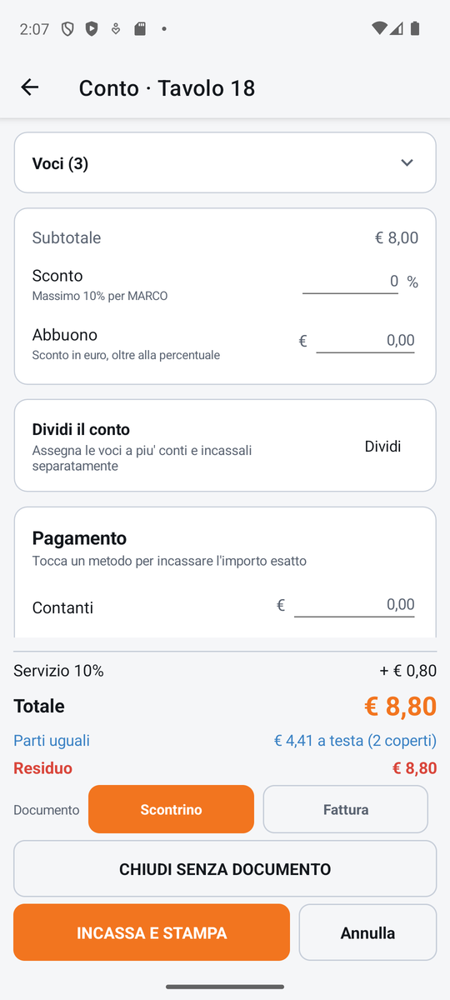
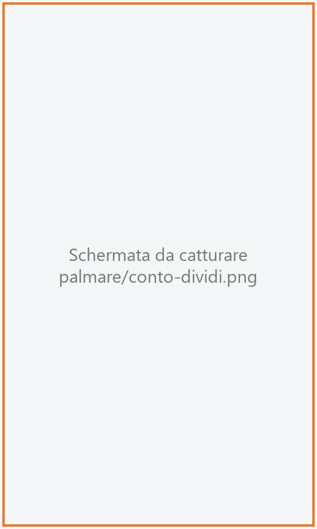
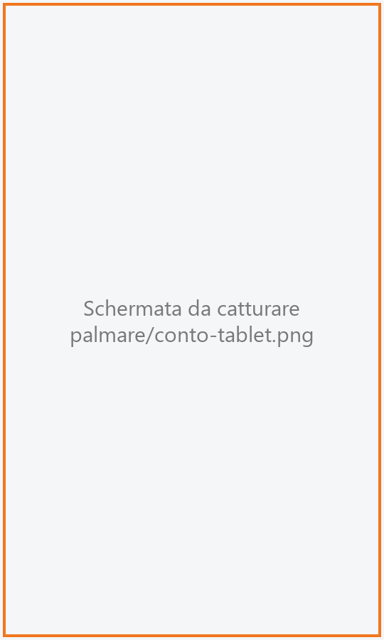

# Conto

La schermata con cui il cameriere incassa il tavolo direttamente dal palmare: vede il totale, mette
lo sconto se è abilitato, scrive come paga il cliente ed emette lo scontrino o la fattura. Da qui si
può anche **dividere il conto** fra più persone e incassarlo un pezzo alla volta.

!!! info "In sintesi"

    - **Dove si trova:** Sala ▸ tavolo ▸ **CONTO** (oppure **Vai al conto** dal preconto)
    - **Chi la usa:** cameriere
    - **Disponibile anche su:** Cassa ([Conto](../cassa/conto.md), [Dividi conto](../cassa/dividi-conto.md))

---

## A cosa serve

Quando il tavolo chiede il conto non serve andare alla cassa: dal palmare il cameriere incassa i
contanti, fa passare la carta sul terminale assegnato al palmare, emette lo scontrino sulla
stampante fiscale del locale e libera il tavolo. Se i clienti vogliono pagare separatamente, con
**Dividi** assegna le voci ai conti 1, 2, 3… e li incassa uno per uno, ognuno con il suo scontrino.

Il documento fiscale non lo stampa il palmare: lo emette il servizio sulla stampante fiscale
configurata per il locale.

## Prima di cominciare

- Tutti i piatti devono essere stati mandati in cucina: il pulsante **CONTO** compare solo allora.
- Una stampante fiscale configurata sul servizio e, se ce n'è più d'una, quella di questo palmare scelta in [Impostazioni](impostazioni.md) (altrimenti vale la predefinita).
- Per incassare con la carta dal palmare: un terminale POS assegnato al palmare in
  Impostazioni ▸ **Pagamento con carta**. Senza, la carta si batte a mano sul POS e qui si scrive
  solo l'importo.
- Per lo sconto: il permesso e lo sconto massimo dell'operatore (vedi
  [Operatori](../cassa/operatori.md)).

## La schermata

{ .telefono }

Il titolo dice cosa stai incassando: «Conto · Tavolo 12», oppure «Conto 2 · Tavolo 12» o «Resto del
conto · Tavolo 12» quando incassi una parte di un conto diviso. Per un ordine d'asporto il titolo è
solo «Conto».

La parte alta scorre e contiene, una sotto l'altra:

- **Voci (N)**: l'elenco di quello che si paga, chiuso all'apertura. Toccando l'intestazione si apre
  e si richiude. Ogni voce ha quantità, descrizione e importo; i coperti sono una voce («Coperto»).
  Una voce offerta ha importo zero e la scritta dell'omaggio in azzurro. Se parte del tavolo è già
  stata pagata compare *Parte di questo tavolo e' gia' stata incassata: qui c'e' solo quello che
  resta.*;
- il riquadro dello **sconto**: **Subtotale**, **Sconto** in percentuale (con sotto lo sconto
  massimo consentito all'operatore), **Abbuono** in euro, e **Sconto applicato** quando c'è;
- **Dividi il conto** con il pulsante **Dividi**;
- **Pagamento**: le cinque righe **Contanti**, **Carta**, **Bancomat**, **Buoni pasto**, **Credito**,
  ognuna con il suo importo in euro. «Tocca un metodo per incassare l'importo esatto».

La parte bassa è fissa e resta visibile anche con la tastiera aperta:

- il **servizio**, se la sala lo prevede (es. «Servizio 10%» con l'importo);
- **Totale**;
- **Parti uguali**: quanto viene a testa dividendo in parti uguali, es. «€ 18,50 a testa
  (4 coperti)». È solo un numero da leggere;
- **Pagato**, **Residuo** (in rosso, quello che manca) e **Resto** (in verde, da restituire);
- **Documento**: le pastiglie **Scontrino**, **Fattura** e, se il locale è collegato all'hotel,
  **Camera**;
- con la fattura, il campo **Scegli il cliente**; con la camera, il campo **Scegli la camera**;
- **CHIUDI SENZA DOCUMENTO**;
- il pulsante di incasso e **Annulla**.

Il pulsante di incasso dice cosa succederà: **INCASSA E STAMPA** (scontrino),
**INCASSA ED EMETTI FATTURA**, **ADDEBITA IN CAMERA**, oppure **STAMPA SCONTRINO** /
**EMETTI FATTURA** quando la carta è già stata addebitata.

### Dividi il conto

{ .telefono }

**Dividi** apre la schermata **Dividi il conto**:

- in alto la striscia dei **conti** («Conto 1», «Conto 2»…), ognuno con il suo totale; quello
  attivo è arancione. Il pulsante **+** apre un conto nuovo;
- due schede: **DA DIVIDERE**, con l'importo che non è ancora su nessun conto, e quella del conto
  attivo (es. «Conto 2»), con il numero di voci («vuoto», «1 voce», «3 voci»). Sulla scheda del
  conto compare anche il pulsante per **svuotarlo**;
- la lista della scheda scelta:
    - in **DA DIVIDERE** le voci ancora libere, con quantità, descrizione, prezzo cadauno, eventuale
      «OMAGGIO» o «1 su altri conti», importo e una freccia a destra. «tocca = una · freccia =
      tutte»: un tocco sulla voce ne mette una sul conto attivo, la freccia la mette tutta. I
      coperti hanno il bordo azzurro;
    - nella scheda del conto le voci già sul conto: «tocca una voce per rimandarla fra quelle da
      dividere»;
- in fondo «Resta € …» con **Incassa il resto**, e il nome e il totale del conto attivo con
  **INCASSA**.

!!! note "Sul tablet"

    Nella forma tablet il conto è su due colonne: a sinistra le voci (sempre aperte), lo sconto e
    **Dividi il conto**; a destra, in una colonna fissa, il pagamento, i totali, il documento e i
    pulsanti. **Dividi il conto** è su tre colonne: **CONTI** (con **+ Nuovo conto**) a sinistra,
    **DA DIVIDERE** al centro, il conto attivo a destra con **Totale** e **INCASSA QUESTO CONTO**.

    

## Campi e indicatori

| Elemento | Descrizione |
|---|---|
| **Voci (N)** | Le voci da pagare e quante sono. Incassando un conto diviso sono solo le sue quote. |
| **Subtotale** | Somma delle voci, coperti compresi. |
| **Sconto** | Percentuale di sconto sul conto intero. Sotto: «Massimo 10% per Mario» oppure «Mario non e' abilitato agli sconti». |
| **Abbuono** | «Sconto in euro, oltre alla percentuale». |
| **Sconto applicato** | Il totale di sconto e abbuono. |
| **Contanti / Carta / Bancomat / Buoni pasto / Credito** | Quanto paga il cliente con ciascun metodo. Toccando il **nome** del metodo il campo si riempie con quello che manca. <!-- DA VERIFICARE: «Credito» è il «non riscosso» (importo lasciato a credito del cliente)? Come va spiegato all'utente? --> |
| **Servizio** | La percentuale di servizio della sala, se c'è. |
| **Totale** | Quello che si paga: voci meno sconto, più servizio. |
| **Parti uguali** | Totale diviso per i coperti ancora da pagare, arrotondato per eccesso. Compare sul conto intero con almeno due coperti. |
| **Pagato / Residuo / Resto** | Somma dei pagamenti scritti, quanto manca, quanto restituire. |
| **Documento** | **Scontrino** (predefinito), **Fattura** o **Camera**. |
| **Scegli il cliente** | Con la fattura: il cliente a cui è intestata (vedi sotto). |
| **Scegli la camera** | Con l'addebito in camera: l'ospite dell'hotel a cui addebitare. |

Con la **Fattura** si apre la finestra **Cliente della fattura**: cerchi per «P.IVA, codice fiscale o
nome», scegli il cliente dai risultati oppure tocchi **Cliente nuovo** e compili la scheda (Persona o
Azienda, nome, partita IVA, codice fiscale, indirizzo, codice destinatario o PEC, email…), poi
**Usa questo cliente**. È la stessa finestra della cassa: vedi [Conto](../cassa/conto.md).

## Pulsanti e comandi

| Comando | Effetto |
|---|---|
| **Voci (N)** | Apre o chiude l'elenco delle voci. |
| **Nome di un metodo di pagamento** | Riempie quel campo con il residuo. |
| **Dividi** | Apre **Dividi il conto**. Non c'è quando stai già incassando un singolo conto. |
| **Scontrino / Fattura / Camera** | Sceglie il documento. |
| **INCASSA E STAMPA** (e varianti) | Incassa: prima la carta sul terminale, se c'è un importo su Carta o Bancomat; poi emette il documento e chiude il conto. |
| **CHIUDI SENZA DOCUMENTO** | Chiude e libera il tavolo senza emettere lo scontrino. Solo per chi ha il permesso di chiusura; chiede conferma. |
| **Annulla** | Torna alla comanda senza incassare. |
| **+** (in Dividi) | Apre un conto nuovo. |
| **Tocco su una voce DA DIVIDERE** | Ne mette una sul conto attivo (per i piatti a peso, tutta la voce). |
| **Freccia sulla voce** | Mette tutta la voce sul conto attivo. |
| **Tocco su una voce del conto** | La rimanda fra quelle da dividere. |
| **Svuota** (scheda del conto) | Rimette tutto il conto fra le voci da dividere, dopo conferma. |
| **INCASSA** (in Dividi) | Apre il conto del conto attivo per incassarlo. |
| **Incassa il resto** | Incassa tutto quello che non è su nessun conto. |

Mentre il terminale aspetta la carta compare la finestra «€ 24,00 sul terminale: fai passare la
carta…» con una barra che si svuota e «Ancora 60 s»: tocca il terminale, non il palmare.

## Come si fa

### Incassare tutto il tavolo in contanti

1. Dalla comanda tocca **CONTO**.
2. Tocca la parola **Contanti**: il campo si riempie con il totale. Se il cliente dà di più, scrivi
   la cifra ricevuta (es. 50): compare il **Resto** in verde.
3. Tocca **INCASSA E STAMPA**.
4. Lo scontrino esce sulla stampante fiscale, il tavolo si chiude e si torna in sala; il tavolo è
   di nuovo libero.

### Incassare con la carta

1. Tocca la parola **Carta** (o **Bancomat**): il campo si riempie con il totale.
2. Tocca **INCASSA E STAMPA**.
3. Compare «… sul terminale: fai passare la carta…»: il cliente paga sul POS.
4. Con la carta autorizzata esce lo scontrino e il tavolo si chiude.

Se dopo la carta lo scontrino non esce, il pulsante diventa **STAMPA SCONTRINO**: toccandolo non si
addebita di nuovo la carta.

### Fare uno sconto

1. Nel riquadro dello sconto scrivi la percentuale in **Sconto** (es. 10) e/o l'importo in
   **Abbuono**.
2. Controlla **Sconto applicato** e il nuovo **Totale**.
3. Incassa come al solito.

### Far pagare separatamente

1. Tocca **Dividi**.
2. Con il **Conto 1** attivo, nella scheda **DA DIVIDERE** tocca le voci del primo cliente (un tocco =
   una porzione, freccia = tutta la voce). Metti anche i suoi coperti.
3. Tocca **+** per aprire il **Conto 2** e assegna le voci del secondo cliente.
4. Seleziona il conto da incassare nella striscia in alto e tocca **INCASSA**.
5. Nel conto che si apre incassa come al solito.
6. Si torna a **Dividi il conto** con l'avviso di quanto resta sul tavolo; incassa gli altri conti o
   **Incassa il resto**. Quando è stato pagato tutto il tavolo si chiude.

### Emettere la fattura

1. Tocca **Fattura**: si apre la finestra del cliente.
2. Cerca il cliente per partita IVA, codice fiscale o nome e toccalo, oppure tocca **Cliente nuovo**
   e compila i dati.
3. Tocca **Usa questo cliente**.
4. Scrivi il pagamento e tocca **INCASSA ED EMETTI FATTURA**.

## Controlli e messaggi

| Messaggio | Causa | Cosa fare |
|---|---|---|
| *Mancano € 5,00 da ripartire fra i metodi di pagamento: il conto non si puo' chiudere finche' l'importo non e' coperto per intero.* | I pagamenti scritti non coprono il totale. | Completa il pagamento. |
| *Nessuna voce da incassare su questo conto.* | Il conto è vuoto. | Nessuna. |
| *Mario non e' abilitato ad applicare sconti.* / *Mario non ha uno sconto massimo impostato: va messo in Impostazioni -> Operatori.* | Lo sconto non è permesso all'operatore. Il valore torna quello di prima. | Fai fare lo sconto a chi è abilitato. |
| *Sconto 15% oltre il massimo consentito a Mario (10%).* | Sconto più abbuono superano il massimo dell'operatore. L'incasso è bloccato. | Riduci lo sconto. |
| *Mario non e' abilitato a chiudere un conto senza documento fiscale.* | **CHIUDI SENZA DOCUMENTO** senza permesso. | Chiedi a un collega abilitato. |
| **Chiudi senza documento** — *Il tavolo verra' chiuso e liberato per € 42,00 SENZA emettere nessuno scontrino. Procedere?* | Conferma della chiusura senza documento. | **Chiudi** o **Annulla**. |
| *Stai emettendo una fattura: e' quello il documento del conto. Per chiudere senza documento torna su Scontrino.* | Chiusura senza documento con la fattura scelta. | Scegli **Scontrino**. |
| *Lo scontrino di questo conto e' gia' stato emesso: la fattura va fatta dal gestionale.* | Fattura dopo lo scontrino. | Fai la fattura dal gestionale. |
| *Pagamento con carta non riuscito: …* | Il terminale ha rifiutato la carta. Il conto resta aperto. | Riprova o cambia metodo. |
| *Nessuna risposta dal terminale: … IL PAGAMENTO POTREBBE ESSERE PASSATO LO STESSO. …* | Il terminale non ha risposto in tempo. | Controlla sul POS (o la sua ultima ricevuta) **prima** di riprovare. |
| *La stampante fiscale n. X non è nell'elenco del servizio.* | La stampante scelta per questo palmare è stata tolta dall'elenco. | Scegline un'altra in Impostazioni ▸ **Stampanti fiscali**; nel frattempo usa CHIUDI SENZA DOCUMENTO se sei abilitato. |
| *La stampante fiscale n. X non è configurata (manca l'indirizzo).* | La stampante scelta non ha l'indirizzo. | Fallo scrivere dalla cassa, in Impostazioni ▸ **Stampanti fiscali**. |
| *La stampante fiscale non ha risposto: …* | Lo scontrino potrebbe essere uscito. | Tocca di nuovo il pulsante di incasso: il servizio controlla e non ristampa. Non rifar passare la carta. |
| **Scontrino: esito incerto** — *… Guarda la stampante fiscale: lo scontrino di € 42,00 e' uscito?* | Il servizio non riesce a sapere se lo scontrino è uscito. | Guarda la stampante e rispondi **E' uscito** o **Non e' uscito**. |
| *Su questo impianto non c'e' una stampante fiscale configurata: per liberare il tavolo usa CHIUDI SENZA DOCUMENTO, e lo scontrino lo emetti piu' tardi da Storico conti.* | Nessuna stampante fiscale. | Chiudi senza documento e documenta poi dalla cassa ([Storico conti](../cassa/storico-conti.md)). |
| *Conto 2 incassato. Restano € 30,00 da incassare su questo tavolo.* | Hai incassato una parte del tavolo diviso. | Incassa le parti rimanenti. |
| *Questo conto e' stato chiuso da un altro dispositivo.* | Il tavolo è stato incassato altrove mentre eri qui. | Torna in sala. |
| *Conto 1 e' ancora vuoto: riempi quello prima di aprirne un altro. Un conto esiste solo quando ha qualcosa dentro.* | **+** con un conto vuoto già aperto. | Metti delle voci sul conto vuoto. |
| *Non resta niente da dividere: un conto nuovo nascerebbe vuoto e ci resterebbe. Rimetti prima qualcosa fra le voci da dividere, oppure incassa uno dei conti.* | **+** quando tutto è già su un conto. | Incassa i conti o rimanda delle voci fra quelle da dividere. |
| **Svuota conto** — *Rimettere tutto quello che c'e' su Conto 2 fra le voci da dividere?* | Hai toccato il pulsante per svuotare il conto. | **Svuota** o **Annulla**. |
| *Impossibile chiudere il conto.* / *Impossibile caricare il conto.* / *Impossibile aggiornare la divisione del conto.* | Il servizio non risponde o rifiuta. Sotto compare il motivo. | Controlla la rete e riprova. |

## Note

- **Un documento emesso non si ritira**: per questo sconto, cliente della fattura e pagamenti si
  controllano prima di toccare il pulsante di incasso.
- Prima si incassa la carta, poi si emette il documento: se la carta viene rifiutata non esce
  niente e il conto resta aperto. Una carta già addebitata resta ricordata anche se esci dalla
  schermata, finché il conto non è chiuso.
- Dopo che la carta è passata (o lo scontrino è uscito) gli importi non si possono più cambiare.
- Sul palmare non c'è la cassa automatica: i contanti si incassano a mano.
- Sul conto diviso lo sconto non si applica (vale solo sul conto intero).
- Durante l'incasso la schermata non si aggiorna con le modifiche fatte da altri dispositivi.

<!-- DA VERIFICARE: sul palmare non c'è una riga di stato nella schermata del conto: i messaggi informativi del modello (es. "Carta autorizzata (STAN ...)", "Fattura n. ... di € ...", "La carta e' GIA' stata addebitata ...: premi ...") non compaiono. È voluto? -->

## Vedi anche

- [Comanda](comanda.md)
- [Sala](sala.md)
- [Conto sulla cassa](../cassa/conto.md)
- [Dividi conto sulla cassa](../cassa/dividi-conto.md)
- [Storico conti](../cassa/storico-conti.md)
- [Impostazioni](impostazioni.md)
