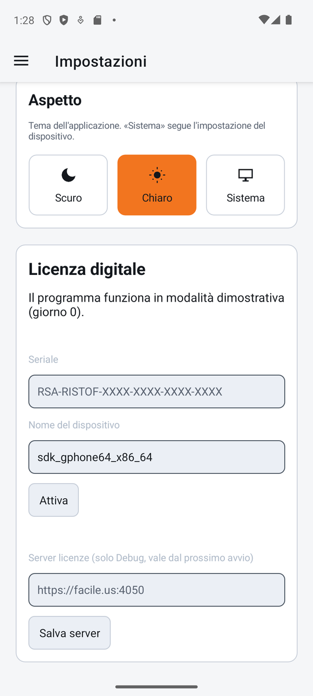
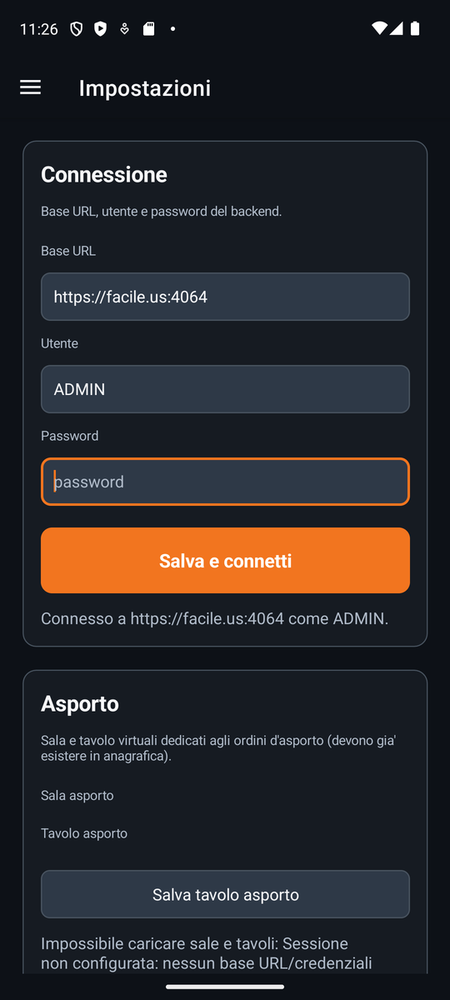
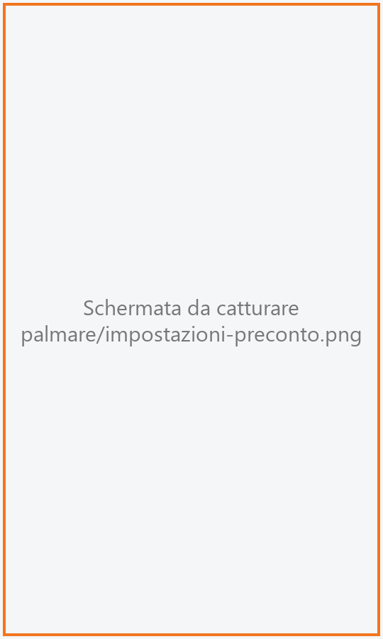
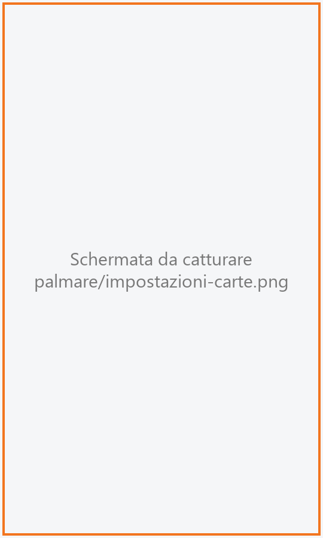
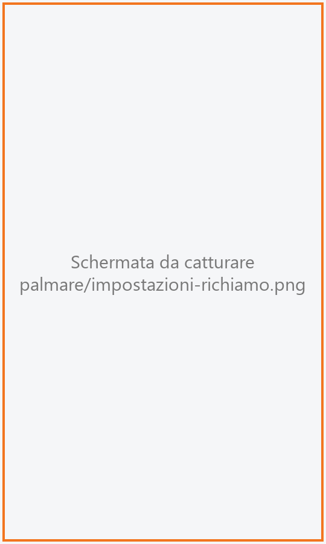

# Impostazioni

Da qui si prepara il palmare: a quale servizio si collega, su quale stampante esce il preconto,
con quale terminale POS incassa le carte, chi è in turno, se avvisare il cameriere quando un
piatto è pronto, il tema e la licenza digitale. Configura **il dispositivo**: sale, tavoli, menu,
operatori e il resto dell'anagrafica si gestiscono dalla cassa.

!!! info "In sintesi"

    - **Dove si trova:** Menu ▸ **Impostazioni** (il menu si apre dall'icona in alto a sinistra)
    - **Chi la usa:** titolare, installatore; cameriere per il turno e il richiamo
    - **Disponibile anche su:** [Cassa](../cassa/impostazioni.md), con più sezioni

---

## A cosa serve

Le voci sono le stesse della cassa e funzionano allo stesso modo: questa scheda descrive solo
**le differenze**. Per il significato dei singoli campi vedi la scheda
[Impostazioni della cassa](../cassa/impostazioni.md).

Rispetto alla cassa, sul palmare:

- **non ci sono** Modelli di stampa, Cassa automatica, Dati fiscali, Menu online e Hotel, e
  nella parte della sala manca il **Tagliando di via in cucina**;
- **c'è in più** il **Richiamo dalla cucina**;
- la licenza digitale prende sempre un **posto Mobile**: non si sceglie l'edizione.

## Prima di cominciare

- Sul palmare non si creano sale, tavoli e operatori: devono già esistere, creati dalla cassa
  ([Sale e tavoli](../cassa/sale-e-tavoli.md), [Operatori](../cassa/operatori.md)).
- Le stampanti e i terminali POS sono quelli dell'impianto: se ne servono di nuovi si possono
  aggiungere anche da qui, ma di solito si registrano dalla cassa.

## La schermata

{ .telefono }

Un'unica colonna di riquadri da scorrere, nell'ordine: **Connessione**, **Asporto**, **Stampante
preconto**, **Prenotazioni in mappa**, **Aggiornamento automatico**, **Pagamento con carta**,
**Stampante fiscale**, **Turno**, **Richiamo dalla cucina**, **Aspetto** e in fondo **Licenza
digitale**. Ogni riquadro ha i suoi pulsanti e, sotto, la riga con l'esito.

## Campi e indicatori

### Connessione

{ .telefono }

*Base URL, utente e password del backend.* Gli stessi dati della cassa
(vedi [Connessione](../cassa/impostazioni.md#connessione)); qui l'indirizzo si chiama
**Base URL**.

| Elemento | Descrizione |
|---|---|
| **Base URL** | L'indirizzo del servizio del locale, per esempio `http://192.168.1.50:8080`. |
| **Utente**, **Password** | Come sulla cassa. A differenza della cassa, qui non compare la riga che avvisa della password già salvata: lasciando vuota la password resta comunque quella salvata. |
| **Salva e connetti** | Salva e verifica il collegamento. Sotto: *Connesso a* (indirizzo) *come* (utente)*.* oppure *Non configurato.* |

### Asporto

*Sala e tavolo virtuali dedicati agli ordini d'asporto (devono gia' esistere in anagrafica).*
Come **Sala ▸ Tavolo asporto** della cassa: **Sala asporto**, **Tavolo asporto** e
**Salva tavolo asporto**. La scelta vale solo per questo palmare.

### Stampante preconto

{ .telefono }

*Stampante ESC/POS di rete su cui esce il preconto. L'elenco è dell'impianto e lo vedono tutti i
dispositivi; qui scegli quale usa questo.*

| Elemento | Descrizione |
|---|---|
| **Stampante di questo dispositivo** | Tendina (*Scegli la stampante*) con le stampanti dell'impianto. Compare solo se l'impianto ne ha. |
| **Indirizzo IP**, **Porta** | Come sulla cassa. |
| **Salva**, **Stampa di prova**, **Verifica stato** | Come sulla cassa. |
| **Togli dall'impianto** | Come **Togli** della cassa: toglie la stampante per tutti i dispositivi. |

### Prenotazioni in mappa e Aggiornamento automatico

Due riquadri separati, con lo stesso significato dei cursori di **Sala ▸ Mappa e servizio**
della cassa. Valgono solo per il palmare: il cameriere può volere un anticipo diverso da chi sta
in cassa.

- **Prenotazioni in mappa**: *Con quanto anticipo segnalare sulla mappa un tavolo prenotato. Zero
  disattiva la segnalazione, il massimo e' 24 ore.* Cursore **Ore di anticipo**.
- **Aggiornamento automatico**: *Ogni quanti secondi le schermate di sala mostrano quello che
  hanno fatto gli altri dispositivi. Zero lo spegne.*

### Pagamento con carta

{ .telefono }

*Il terminale POS su cui questa postazione incassa le carte. Premendo INCASSA, l'importo messo su
Carte o Bancomat viene chiesto al terminale prima di emettere il documento.*

Al posto dell'elenco a sinistra della cassa c'è una tendina:

| Elemento | Descrizione |
|---|---|
| **Terminale** | Tendina con i terminali dell'impianto (*Nessun terminale* se vuota). Sceglierne uno apre la sua scheda. |
| **Id cassa** | Come **ID cassa** sulla cassa. |
| **Nuovo terminale** | Apre una scheda vuota. |
| **Scheda del terminale** | **Id**, **Descrizione**, **Id terminale (quello scritto sul POS)**, **Indirizzo IP**, **Porta**, con **Salva**, **Chiudi** e **Togli**. |
| **Usa qui** | Come **Usa su questa cassa**. |
| **Verifica stato**, **Carte a mano** | Come sulla cassa. |
| **Aggiorna elenco** | Rilegge dal servizio l'elenco dei terminali (solo sul palmare). |
| *Questa postazione incassa su:* | Il terminale in uso. |

### Stampante fiscale

*Registratore telematico in rete. Emissione scontrino al Conto (aggancio in arrivo); qui imposti
tipo e indirizzo.* **Tipo**, indirizzo, **Salva** e **Verifica stato** come sulla cassa.

È la **stessa** impostazione dell'impianto che si vede dalla cassa: cambiarla qui la cambia per
tutti.

<!-- DA VERIFICARE: la frase a video "aggancio in arrivo" sembra superata (sulla cassa lo scontrino al conto esce gia'); confermare se dal palmare lo scontrino esce davvero sulla stampante fiscale. -->

### Turno

**In turno** con il nome dell'operatore (o *Nessun operatore*), e un solo pulsante:
**ESCI** (con un operatore in turno, chiede conferma e torna all'[accesso](accesso.md)) oppure
**ACCEDI** (quando nessuno è in turno).

### Richiamo dalla cucina

{ .telefono }

*Ti avvisa con una notifica quando la cucina segna pronto un piatto, anche ad app chiusa.* Solo
sul palmare.

| Elemento | Descrizione |
|---|---|
| **Avvisami quando è pronto** | Interruttore. Accendendolo il telefono chiede il permesso di mostrare le notifiche. |
| **Solo i miei tavoli** | Compare con il richiamo acceso. *Spento: ti avviso per i piatti di tutti.* Acceso: solo per i tavoli del cameriere in turno. |
| Riga di stato | Con il richiamo acceso: *Attivo. Su Samsung metti RistoApp fra le app «mai in sospensione», o il risparmio energetico lo spegne.* |

Il richiamo funziona sui palmari **Android**. Su iPhone e iPad al momento non è disponibile:
accendendo l'interruttore compare *Permesso notifiche negato: senza, l'avviso non puo'
comparire.* e l'interruttore si rispegne.

### Aspetto

*Tema dell'applicazione. «Sistema» segue l'impostazione del dispositivo.* **Scuro**, **Chiaro**,
**Sistema**, come sulla cassa.

### Licenza digitale

{ .telefono }

L'ultimo riquadro: stato della licenza, **Seriale**, **Nome del dispositivo**, **Attiva** e
**Disattiva questo dispositivo**. Rispetto alla cassa manca la scelta dell'**Edizione**: il
palmare occupa sempre un posto **Mobile** della licenza. Vedi
[Licenza digitale](../introduzione/licenza.md).

## Pulsanti e comandi

| Comando | Effetto |
|---|---|
| **Salva e connetti** | Salva e verifica il collegamento al servizio. |
| **Salva tavolo asporto** | Salva sala e tavolo dell'asporto per questo palmare. |
| **Salva** / **Stampa di prova** / **Verifica stato** / **Togli dall'impianto** | Stampante del preconto, come sulla cassa. |
| **Nuovo terminale** / **Usa qui** / **Carte a mano** / **Aggiorna elenco** | Terminale POS di questo palmare. |
| **Salva** / **Verifica stato** | Stampante fiscale dell'impianto. |
| **ESCI** / **ACCEDI** | Chiude il turno / apre l'accesso. |
| **Avvisami quando è pronto**, **Solo i miei tavoli** | Accendono e spengono il richiamo dalla cucina. |
| **Scuro** / **Chiaro** / **Sistema** | Cambiano il tema. |
| **Attiva** / **Disattiva questo dispositivo** | Licenza digitale. |

## Come si fa

### Collegare un palmare nuovo

1. Apri Menu ▸ **Impostazioni**. Su un palmare mai configurato ci arrivi da solo all'avvio.
2. In **Connessione** scrivi **Base URL**, **Utente** e **Password**.
3. Tocca **Salva e connetti**.
4. Compare *Connesso a* (indirizzo) *come* (utente)*.*
5. In **Stampante preconto** scegli la stampante in **Stampante di questo dispositivo**.
6. In **Turno** tocca **ACCEDI**: si apre l'[accesso](accesso.md).

### Ricevere l'avviso dei piatti pronti

1. Nel riquadro **Richiamo dalla cucina** accendi **Avvisami quando è pronto**.
2. Concedi il permesso alle notifiche quando il telefono lo chiede.
3. Se vuoi gli avvisi solo per i tuoi tavoli, accendi **Solo i miei tavoli**.
4. Compare *Attivo.*: quando la cucina segna pronto un piatto arriva la notifica, anche ad app
   chiusa.

## Controlli e messaggi

I messaggi di Connessione, Asporto, stampanti e POS sono gli stessi della cassa: vedi
[Impostazioni della cassa ▸ Controlli e messaggi](../cassa/impostazioni.md#controlli-e-messaggi).
Quelli propri del palmare:

| Messaggio | Causa | Cosa fare |
|---|---|---|
| *Permesso notifiche negato: senza, l'avviso non puo' comparire.* | Il permesso alle notifiche è stato negato, oppure il dispositivo è un iPhone o un iPad. | Su Android concedi il permesso dalle impostazioni del telefono e riaccendi l'interruttore. |
| *Nessun operatore in turno: con «solo i miei tavoli» non riceverai avvisi. Esci e rientra con il tuo PIN, oppure spegni «solo i miei».* | **Solo i miei tavoli** acceso senza nessuno in turno. | Entra con il tuo nome o spegni **Solo i miei tavoli**. |

## Note

- Alcuni messaggi dicono «cassa» anche sul palmare (per esempio *Questa cassa stampa su…*): si
  riferiscono a questo palmare.
- Stampanti, terminali POS e stampante fiscale sono dell'impianto: **Togli dall'impianto**,
  **Togli** e il salvataggio della stampante fiscale hanno effetto anche sulle casse.
- Su Samsung, se le notifiche smettono di arrivare dopo un po', togli RistoApp dal risparmio
  energetico come indicato nella riga di stato.

## Vedi anche

- [Impostazioni della cassa](../cassa/impostazioni.md)
- [Accesso](accesso.md)
- [Licenza digitale](../introduzione/licenza.md)
- [Prima configurazione](../introduzione/prima-configurazione.md)
- [Io](io.md)
