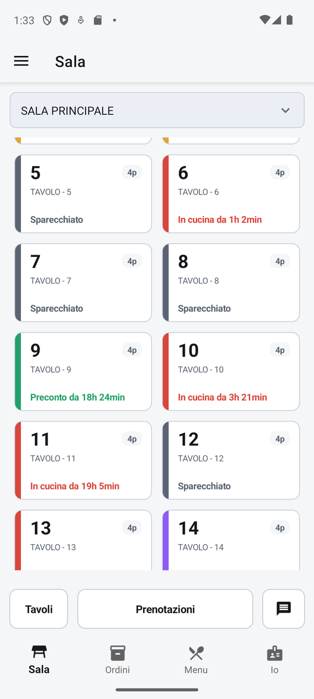

# Palmare

Il palmare è l'app RistoFacile per i camerieri: gira sul telefono o sul tablet e serve a fare in
sala quello che si fa al tavolo, cioè **prendere le comande, mandarle in cucina e incassare**. Si
collega allo stesso servizio della cassa, quindi quello che batti dal palmare compare subito anche
sulla cassa e sul monitor di cucina, e viceversa.

{ .telefono }

## A chi serve

- **Ai camerieri**, che girano fra i tavoli con il telefono in tasca: aprono il tavolo, battono i
  piatti, li mandano in cucina, danno il via alle portate successive e, se serve, fanno il conto.
- **A chi segue l'asporto e le prenotazioni** lontano dalla cassa: la coda degli ordini e il
  registro delle prenotazioni si gestiscono anche da qui.
- **Al titolare in sala**, per controllare i tavoli aperti e il proprio turno.

Prima di cominciare il turno ogni cameriere entra con il proprio PIN (vedi [Accesso](accesso.md)):
tutto quello che batte viene firmato con il suo nome. Il palmare occupa un posto della licenza
digitale del locale (vedi [Licenza digitale](../introduzione/licenza.md)).
<!-- DA VERIFICARE: confermare che il palmare occupi un "posto Mobile" della licenza e come va detto all'utente. -->

## Le linguette in basso

La schermata principale del palmare ha in basso quattro linguette, sempre a portata di pollice:

| Linguetta | Cosa contiene |
|---|---|
| **Sala** | La mappa dei tavoli della sala: tocchi un tavolo e si apre la sua comanda. Da qui anche spostare, unire e separare i tavoli, le prenotazioni e i messaggi alla cucina. Vedi [Sala](sala.md). |
| **Ordini** | La coda degli ordini da asporto e a domicilio, con il pulsante per crearne uno nuovo. Vedi [Ordini](ordini.md). |
| **Menu** | Il menu da consultare, con prezzi, piatti esauriti, scorte basse e allergeni. Non si ordina da qui. Vedi [Menu](menu.md). |
| **Io** | Il tuo turno: chi è in turno, cosa hai battuto oggi, i tuoi tavoli aperti e il pulsante per uscire. Vedi [Io](io.md). |

Quando entri in un tavolo (comanda, conto, composizione di un piatto…) le linguette spariscono per
lasciare tutto lo schermo al lavoro; si torna indietro con la freccia in alto.

Le **Impostazioni** del dispositivo (collegamento al servizio, stampante del preconto, terminale
delle carte, tema, richiamo dalla cucina…) si aprono dal menu laterale, toccando il pulsante in
alto a sinistra: il menu laterale ha due voci, **Vendita** e **Impostazioni**. Vedi
[Impostazioni](impostazioni.md).

## Telefono e tablet

Il palmare sceglie da solo la forma della schermata in base alla **larghezza dello schermo**:

- **forma telefono** (una colonna): sul telefono, che resta sempre in verticale, e sul tablet tenuto
  in verticale;
- **forma tablet** (due o tre colonne affiancate, come sulla cassa): sul tablet tenuto in
  orizzontale.

Le funzioni sono le stesse; cambia la disposizione. Per esempio, sul telefono la comanda ha due
schede **MENU** e **COMANDA** che si alternano, sul tablet il menu e la comanda stanno uno accanto
all'altra. Questo manuale descrive la forma telefono; dove il tablet è diverso lo trovi in un
riquadro **Sul tablet**.

Girando il tablet la forma cambia appena torni a una schermata principale (mappa, ordini, menu, io):
dentro un tavolo aperto resta quella di prima, per non perdere quello che stai battendo.

!!! note "Vendita al banco solo sul tablet"

    La **Vendita al banco** (vendite veloci senza tavolo) c'è solo nella forma tablet: nella mappa
    della sala compare il pulsante **Vendita al banco**. Sul telefono il pulsante e la schermata non
    esistono. La schermata è la stessa della cassa: vedi [Vendita al banco](../cassa/vendita-al-banco.md).

## Cosa non c'è sul palmare

Il palmare è lo strumento del cameriere: prende comande e incassa. Alcune cose si fanno solo dalla
[cassa](../cassa/index.md), dove ci sono lo schermo grande e la tastiera per farle, e non è una
mancanza da correggere:

- **le anagrafiche**: sale e tavoli, menu, articoli, modificatori, varianti, disponibilità, centri
  di produzione, portate, regole di composizione, operatori. Sul palmare si vedono e si usano, ma
  si creano e si modificano solo dalla cassa. Per questo alcune schermate vuote del palmare dicono,
  per esempio, *I tavoli si configurano dalla cassa*;
- **la cassa automatica** (la macchina che incassa i contanti e dà il resto): sta sul bancone ed è
  collegata alla cassa; dal palmare i contanti si incassano a mano;
- fatture emesse, storico dei conti, statistiche e menu online da tavolo, che sono funzioni di
  amministrazione della cassa.

Il pagamento con carta invece c'è anche sul palmare, se nelle Impostazioni gli è stato assegnato un
terminale POS.

## Le schermate del palmare

- [Accesso](accesso.md)
- [Sala](sala.md)
- [Comanda](comanda.md)
- [Conto](conto.md)
- [Ordini](ordini.md)
- [Prenotazioni](prenotazioni.md)
- [Menu](menu.md)
- [Io](io.md)
- [Messaggi](messaggi.md)
- [Impostazioni](impostazioni.md)
