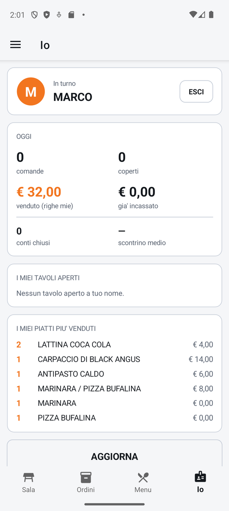

# Io

La scheda del tuo turno: chi è in turno sul palmare, come sta andando la giornata (comande,
coperti, venduto, incassato), quali tavoli hai ancora aperti e quali piatti hai battuto di più. Da
qui si esce a fine turno.

!!! info "In sintesi"

    - **Dove si trova:** linguetta **Io**
    - **Chi la usa:** cameriere
    - **Disponibile anche su:** solo palmare

---

## A cosa serve

Fra un tavolo e l'altro il cameriere guarda quanti coperti ha servito e quali tavoli ha ancora
aperti; a fine serata controlla di non aver lasciato tavoli aperti e tocca **ESCI**, così il palmare
non firma più le comande con il suo nome e può passare a un collega.

## Prima di cominciare

- Devi essere entrato con il tuo PIN (vedi [Accesso](accesso.md)).

## La schermata

{ .telefono }

La schermata scorre e ha, una sotto l'altra, queste schede:

- **In turno**: l'iniziale e il nome dell'operatore, con il pulsante **ESCI**;
- **OGGI**: i numeri della giornata, grandi;
- **I MIEI TAVOLI APERTI**: per ogni tavolo sala e tavolo (es. «Sala principale - Tavolo 12»), i
  coperti, da quanto è aperto e il totale fin qui; «Nessun tavolo aperto a tuo nome.» se non ce ne
  sono;
- **I MIEI PIATTI PIU' VENDUTI**: fino a dieci piatti, con la quantità, il nome e l'importo;
  «Non hai ancora battuto righe oggi.» se non ce ne sono;
- il pulsante **AGGIORNA**.

Se il riepilogo non si può leggere, sotto la scheda dell'operatore compare un riquadro rosso con
il motivo.

!!! note "Sul tablet"

    Sul tablet la linguetta **Io** è la stessa schermata. In più, nella comanda del tablet il nome
    dell'operatore e **ESCI** stanno anche nella pastiglia **OPERATORE** in alto a destra.

## Campi e indicatori

| Elemento | Descrizione |
|---|---|
| **In turno** | L'operatore entrato con il PIN su questo palmare. |
| **comande** | Le comande (tavoli) aperte oggi da te. |
| **coperti** | I coperti delle tue comande di oggi. |
| **venduto (righe mie)** | Il valore dei piatti battuti da te oggi, anche su tavoli dei colleghi; i piatti stornati non contano, quelli in omaggio valgono zero. |
| **gia' incassato** | Quanto di quei piatti, e dei coperti dei tuoi tavoli, è già stato pagato. |
| **conti chiusi** | Le tue comande di oggi già incassate. |
| **scontrino medio** | Il **gia' incassato** diviso per i **conti chiusi** («—» se non hai conti chiusi). È un valore indicativo: l'incassato comprende anche i tuoi piatti pagati su tavoli dei colleghi. |
| **I MIEI TAVOLI APERTI** | Le tue comande di oggi non ancora incassate, con il totale di tutte le loro righe (anche quelle battute dai colleghi). |
| **I MIEI PIATTI PIU' VENDUTI** | I dieci piatti che hai battuto di più oggi, per quantità. |

Le comande sono attribuite a chi ha **aperto** il tavolo, le righe a chi le ha **battute**: per
questo i due numeri possono riguardare tavoli diversi.

## Pulsanti e comandi

| Comando | Effetto |
|---|---|
| **ESCI** | Chiude il turno sul palmare, dopo conferma, e torna alla schermata di [Accesso](accesso.md). |
| **AGGIORNA** | Rilegge il riepilogo. Il riepilogo si rilegge anche ogni volta che apri la linguetta. |

## Come si fa

### Chiudere il turno

1. Tocca la linguetta **Io**.
2. Controlla **I MIEI TAVOLI APERTI**: se ci sono tavoli da chiudere, passali a un collega o
   chiudili.
3. Tocca **ESCI**.
4. Alla domanda **Fine turno** tocca **Esci**.
5. Compare la schermata di [Accesso](accesso.md): il prossimo cameriere entra con il suo PIN.

## Controlli e messaggi

| Messaggio | Causa | Cosa fare |
|---|---|---|
| **Fine turno** — *Vuoi uscire? Mario non firmera' piu' le comande su questo dispositivo, e per rientrare servira' il PIN.* | Hai toccato **ESCI**. | **Esci** per chiudere il turno, **Annulla** per restare. |
| *Impossibile leggere il riepilogo del turno.* | Il servizio non risponde (sotto compare il motivo). | Controlla la rete e tocca **AGGIORNA**. |

## Note

- I tavoli aperti elencati qui non si toccano: per aprirne uno passa dalla [Sala](sala.md).
- Uscire non chiude né sposta i tuoi tavoli: restano aperti, a tuo nome, e qualunque collega li può
  continuare.
- Il riepilogo vale per la giornata di oggi.
- In una versione di prova dell'app compare anche una scheda **RETE**, con i tempi delle ultime
  chiamate al servizio: serve all'assistenza e nella versione definitiva non c'è.

## Vedi anche

- [Accesso](accesso.md)
- [Sala](sala.md)
- [Impostazioni](impostazioni.md)
