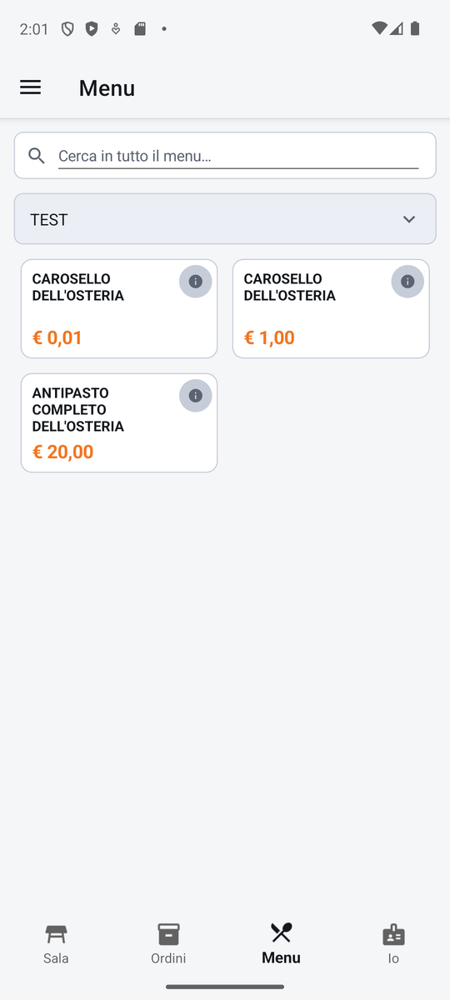
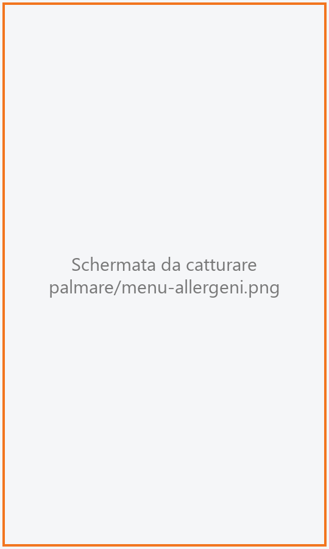

# Menu

Il menu del locale, da sfogliare sul telefono: per ogni piatto il prezzo, se è esaurito o sta
finendo, e gli allergeni. È di sola consultazione: da qui **non si ordina**, si ordina dalla
[Comanda](comanda.md) del tavolo.

!!! info "In sintesi"

    - **Dove si trova:** linguetta **Menu**
    - **Chi la usa:** cameriere
    - **Disponibile anche su:** solo palmare (sulla cassa il menu si consulta dalla [Comanda](../cassa/comanda.md))

---

## A cosa serve

Il cliente chiede «c'è ancora il pesce spada?» o «la torta ha il glutine?». Il cameriere apre la
linguetta **Menu**, cerca il piatto e risponde senza aprire un tavolo e senza rischiare di battere
qualcosa per sbaglio.

## Prima di cominciare

*Nessun prerequisito.* Il menu si compone dalla cassa (vedi [Menu](../cassa/menu.md)).

## La schermata

{ .telefono }

Dall'alto:

- **Cerca in tutto il menu…**: scrivi una parte del nome; compaiono i piatti di tutte le sezioni che
  la contengono, ognuno con il nome della sua sezione sopra;
- **il campo della sezione**: il nome della sezione aperta («Scegli la sezione» se non ce n'è
  ancora una). Toccandolo si apre l'elenco **Sezione**, con tutte le sezioni e il numero di articoli
  di ciascuna (es. «12 articoli»); la sezione aperta ha il bordo arancione;
- **la griglia dei piatti** della sezione, con le stesse tessere della comanda: nome, prezzo (per i
  piatti a peso il prezzo al chilo, «/kg»), il pulsante **i** degli allergeni, e i riquadri
  **ULTIME 3** (in ambra) o **ESAURITO** (in rosso). Toccare la tessera non fa niente.

Toccando **i** si apre il pannello **ALLERGENI** con il nome del piatto e, per ogni allergene,
«contiene» oppure «puo' contenere tracce».

{ .telefono }

!!! note "Sul tablet"

    Sul tablet la linguetta **Menu** è la stessa schermata, con più colonne di tessere.

## Campi e indicatori

| Elemento | Descrizione |
|---|---|
| **Cerca in tutto il menu…** | Ricerca per nome su tutte le sezioni. |
| **Campo della sezione** | La sezione aperta; toccalo per cambiarla. |
| **Prezzo** | Il prezzo del listino predefinito del locale, compreso l'eventuale supplemento del menu. |
| **ULTIME N** | Restano N porzioni. |
| **ESAURITO** | Il piatto è finito. |
| **i** | Gli allergeni del piatto. |

## Pulsanti e comandi

| Comando | Effetto |
|---|---|
| **Campo della sezione** | Apre l'elenco **Sezione**; tocca una sezione per vederne i piatti. |
| **i** | Apre il pannello **ALLERGENI**. Si chiude con la **X** o toccando fuori. |

## Come si fa

### Controllare gli allergeni di un piatto

1. Tocca la linguetta **Menu**.
2. In **Cerca in tutto il menu…** scrivi una parte del nome (es. «torta»).
3. Tocca **i** sulla tessera del piatto.
4. Si apre **ALLERGENI** con l'elenco: rispondi al cliente distinguendo «contiene» da «puo'
   contenere tracce».

## Controlli e messaggi

| Messaggio | Causa | Cosa fare |
|---|---|---|
| *Nessun allergene dichiarato per questo articolo.* | Il piatto non ha allergeni registrati. | Se il cliente ha un'allergia seria, chiedi comunque in cucina. |
| *Allergeni non leggibili: il server non risponde. Chiedi in cucina prima di rispondere al cliente.* | Il servizio non ha risposto. | Chiedi in cucina. |
| *Nessun articolo in questa sezione* — *Il menu si compone dalla cassa* | La sezione è vuota. | Nessuna. |
| *Nessuna sezione da mostrare.* | Il menu non ha sezioni. | Componi il menu dalla cassa. |
| *Impossibile caricare il menu.* | Il servizio non risponde. | Controlla la rete e riapri la linguetta. |

## Note

- I prezzi sono quelli del **listino predefinito** del locale: se una sala usa un listino diverso,
  in [Comanda](comanda.md) il prezzo può essere diverso da quello mostrato qui.
- Qui compaiono **tutte** le sezioni, anche quelle dei menu che in quel giorno o a quell'ora non
  sono in vendita; nella comanda invece si vedono solo quelle dei menu validi in quel momento.
- Le regole di composizione (mezza e mezza) e i menu a prezzo fisso non compaiono qui: si usano dalla
  [Comanda](comanda.md).
- Esauriti e scorte basse si rileggono ogni volta che apri la linguetta, non mentre la guardi: per
  vederli aggiornati cambia linguetta e torna. Tornando, resta aperta la stessa sezione.

## Vedi anche

- [Comanda](comanda.md)
- [Menu sulla cassa](../cassa/menu.md)
- [Disponibilità](../cassa/disponibilita.md)
