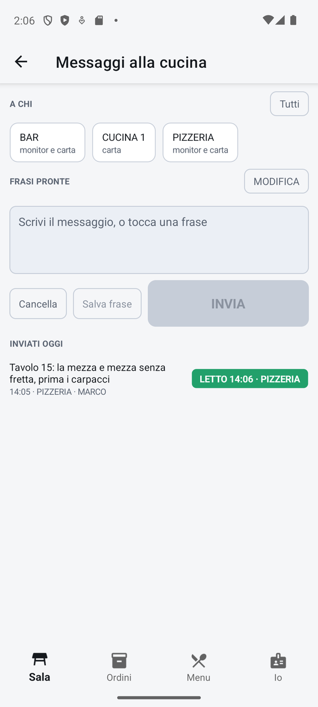

# Messaggi alla cucina

Un modo per parlare con la cucina (o il bar, la pizzeria) senza andarci: scrivi o scegli una frase
pronta, scegli a chi mandarla e tocca **INVIA**. Il messaggio compare a tutto schermo sul monitor di
cucina, oppure esce stampato sulla stampante del centro; sul palmare vedi quando è stato letto.

!!! info "In sintesi"

    - **Dove si trova:** Sala ▸ icona dei messaggi nella barra in basso (sul tablet: pulsante **Messaggi**)
    - **Chi la usa:** cameriere
    - **Disponibile anche su:** Cassa ([Messaggi](../cassa/messaggi.md))

---

## A cosa serve

«Il tavolo 7 ha fretta», «Tavolo 4: senza glutine per la signora», «Rallentate i secondi del 12»:
cose da dire alla cucina mentre lavora. Il messaggio arriva sul monitor del centro scelto e resta a
schermo finché qualcuno non tocca **LETTO**; il cameriere vede «LETTO 20:41 · Giuseppe» e sa che è
arrivato.

## Prima di cominciare

- I centri di produzione attivi, creati dalla cassa (vedi
  [Centri di produzione](../cassa/centri-di-produzione.md)).
- Per i centri con il monitor: il monitor di cucina acceso sul centro (vedi
  [Scelta del centro](../kds/centro.md)).

## La schermata

{ .telefono }

Il titolo è **Messaggi alla cucina**. La schermata ha tre fasce:

- **A CHI**: i centri di produzione attivi, in pastiglie che scorrono di lato. Ognuna porta il nome
  del centro e, sotto, dove arriva il messaggio: «monitor», «carta» o «monitor e carta». Le pastiglie
  scelte hanno il bordo arancione. A destra il pulsante **Tutti**. Se il locale ha un solo centro, è
  già scelto;
- **FRASI PRONTE**: le frasi salvate, in pastiglie che vanno a capo, con il pulsante **MODIFICA**.
  Sotto, la casella del testo («Scrivi il messaggio, o tocca una frase») e i pulsanti **Cancella**,
  **Salva frase** e **INVIA**;
- **INVIATI OGGI**: i messaggi mandati oggi, con il testo, l'ora, il centro e chi l'ha mandato, e a
  destra lo stato. È l'unica parte che scorre, e si aggiorna da sola ogni pochi secondi.

!!! note "Sul tablet"

    Sul tablet le tre fasce diventano tre colonne affiancate: **A CHI** a sinistra, le frasi e il
    testo al centro (il pulsante si chiama **Salva come frase**), **INVIATI OGGI** a destra.

## Campi e indicatori

| Elemento | Descrizione |
|---|---|
| **A CHI** | I centri a cui mandare il messaggio. Se ne possono scegliere più di uno. |
| **monitor / carta / monitor e carta** | Dove arriva il messaggio per quel centro. Un centro solo su carta non potrà mai risultare «letto». |
| **FRASI PRONTE** | Frasi già scritte: toccandone una si aggiunge al testo. |
| **Casella del testo** | Il messaggio, fino a 500 caratteri. |
| **Stato del messaggio** | **NON LETTO** (in giallo) finché il monitor non lo conferma; **LETTO 20:41 · Giuseppe** (in verde) dopo. Per i centri solo carta: **STAMPATO** oppure **NON STAMPATO**. |

## Pulsanti e comandi

| Comando | Effetto |
|---|---|
| **Tocco su un centro** | Lo sceglie o lo toglie. |
| **Tutti** | Sceglie tutti i centri; se erano già tutti scelti, li toglie. |
| **Tocco su una frase** | Aggiunge la frase in fondo al testo. |
| **MODIFICA** / **FATTO** | Accende e spegne la modifica delle frasi: in modifica ogni frase ha una **X** rossa e toccarla la cancella. |
| **Cancella** | Svuota la casella del testo. |
| **Salva frase** | Aggiunge il testo scritto alle frasi pronte. |
| **INVIA** | Manda il messaggio ai centri scelti. È spento finché la casella è vuota. |

## Come si fa

### Mandare un messaggio alla cucina

1. Dalla [Sala](sala.md) tocca l'icona dei messaggi.
2. In **A CHI** tocca **CUCINA** (o i centri che servono).
3. Tocca una frase pronta, oppure scrivi il messaggio nella casella.
4. Tocca **INVIA**.
5. Il messaggio compare in **INVIATI OGGI** come **NON LETTO**; quando in cucina toccano **LETTO** sul
   monitor diventa **LETTO** con l'ora e il nome.

### Aggiungere una frase pronta

1. Scrivi la frase nella casella (es. «Tavolo con bambini, primi insieme»).
2. Tocca **Salva frase**.
3. La frase compare fra le **FRASI PRONTE**, anche sugli altri dispositivi.

### Togliere una frase pronta

1. Tocca **MODIFICA**.
2. Tocca la frase da togliere (ha la **X** rossa).
3. Tocca **FATTO**.

## Controlli e messaggi

| Messaggio | Causa | Cosa fare |
|---|---|---|
| *Scegli almeno un centro di produzione a cui mandare il messaggio.* | **INVIA** senza centri scelti. | Tocca almeno un centro in **A CHI**. |
| *Invio in corso…* | Il messaggio sta partendo. | Attendi. |
| *Messaggio inviato, ma il foglietto non e' uscito:* seguito dal centro e dal motivo (es. *BAR: nessuna stampante configurata.*) | Il messaggio è registrato, ma la stampa per un centro su carta non è riuscita. | Controlla la stampante del centro, o avvisa a voce. |
| *La frase c'e' gia'.* | **Salva frase** con una frase già presente. | Nessuna. |
| *Il servizio non conosce ancora i messaggi alla cucina: va aggiornato.* | Il servizio installato è di una versione precedente. **INVIA** resta spento. | Fai aggiornare il servizio. |
| *Il messaggio non e' partito.* | Il servizio ha rifiutato l'invio (sotto compare il motivo). | Riprova. |
| *Non e' stato possibile salvare le frasi.* | Il servizio non ha salvato le frasi. | Riprova. |
| *Impossibile caricare: …* | Il servizio non risponde. | Controlla la rete e riapri la schermata. |
| *Nessun messaggio mandato oggi.* | Nessun invio nella giornata. | Nessuna. |

## Note

- Le frasi pronte sono le stesse per tutti i dispositivi del locale: cancellarne una la toglie a
  tutti.
- Per i centri su carta il foglietto esce sulla stampante del centro (o sul suo ripiego), come le
  comande.
- Sul monitor di cucina il messaggio copre il tabellone finché qualcuno non tocca **LETTO**: vedi
  [Monitor](../kds/monitor.md).
- Il messaggio porta il nome dell'operatore in turno sul palmare.

## Vedi anche

- [Sala](sala.md)
- [Messaggi sulla cassa](../cassa/messaggi.md)
- [Monitor di cucina](../kds/monitor.md)
- [Centri di produzione](../cassa/centri-di-produzione.md)
