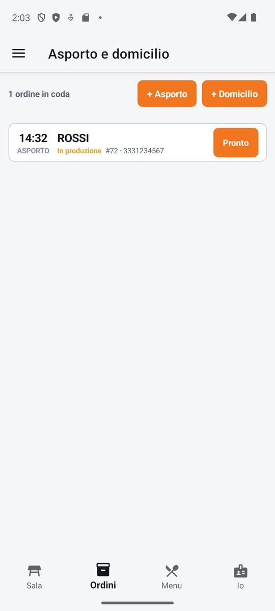
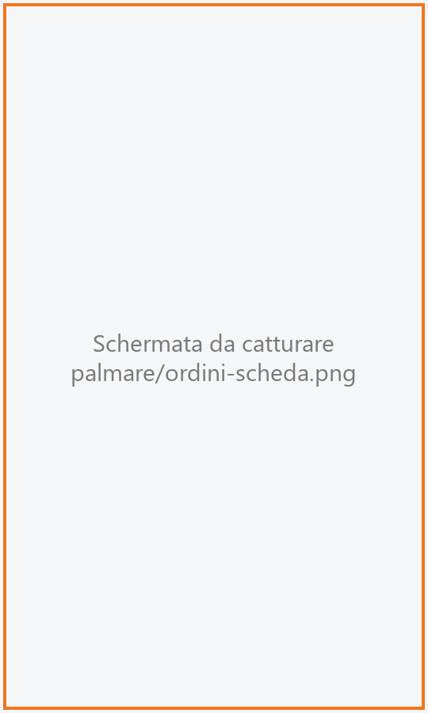
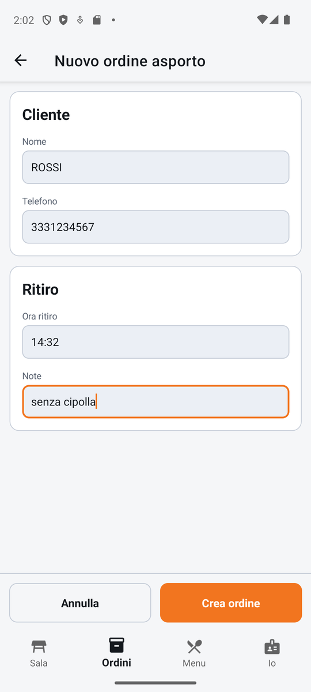

# Ordini

La coda degli ordini **da asporto** (il cliente passa a ritirare) e **a domicilio** (il fattorino
consegna), in ordine di orario. Da qui si crea un nuovo ordine, si fa avanzare ciascun ordine di
stato fino al ritiro o alla consegna e si apre la sua comanda per batterne i piatti.

!!! info "In sintesi"

    - **Dove si trova:** linguetta **Ordini** (anche: Sala ▸ tocco sul tavolo dell'asporto)
    - **Chi la usa:** cameriere, chi risponde al telefono, chi prepara le consegne
    - **Disponibile anche su:** Cassa ([Asporto e domicilio](../cassa/asporto.md))

---

## A cosa serve

Il telefono squilla: un cliente vuole due pizze per le 20:30. Crei l'ordine con nome e ora di
ritiro, batti le pizze nella comanda e le mandi in cucina. Nella coda l'ordine passa da
**Confermato** a **In produzione**, poi **Pronto**; quando il cliente arriva lo segni **Ritirato** e
l'ordine esce dalla coda. Per il domicilio c'è un passaggio in più, **In consegna**, quando parte il
fattorino.

Tutti gli ordini stanno sul **tavolo virtuale dell'asporto**: per questo nella [Sala](sala.md) quel
tavolo porta la scritta **Asporto** e il numero di ordini in coda.

## Prima di cominciare

- Il **tavolo dell'asporto** deve essere scelto in [Impostazioni](impostazioni.md) ▸ Asporto (sala
  e tavolo virtuali, che devono già esistere: si creano dalla cassa in
  [Sale e tavoli](../cassa/sale-e-tavoli.md)).
- Per rifiutare un ordine o segnarlo come non ritirato serve il permesso di annullare (vedi
  [Operatori](../cassa/operatori.md)).

## La schermata

{ .telefono }

Il titolo è **Asporto e domicilio**. Dall'alto:

- **la testata**: a sinistra quanti ordini ci sono (es. «5 ordini in coda», oppure «2 di 5 ordini in
  coda» quando è attivo un filtro), a destra i pulsanti **+ Asporto** e **+ Domicilio**;
- **le pastiglie di stato**, che filtrano la coda: **Tutti (5)**, **Da confermare (1)**,
  **Confermati (2)**, **In produzione (1)**, **Pronti (1)**, **In consegna (0)**. Compare solo la
  pastiglia degli stati che hanno almeno un ordine, e la fascia sparisce del tutto se gli ordini
  sono tutti nello stesso stato. Scorre di lato se non ci sta;
- **la coda**: una riga per ordine, dal più vicino al più lontano. Trascinando la lista verso il
  basso si aggiorna.

Ogni riga porta:

- a sinistra l'**ora** di ritiro o di consegna, grande, e sotto **ASPORTO** o **DOMICILIO**;
- il **nome** del cliente;
- lo **stato** in colore (es. «Pronto» in verde) seguito dal numero dell'ordine e dal telefono, o
  dall'indirizzo per il domicilio (es. «#12 · Via Roma 4, Catania»);
- a destra il pulsante dello **stato successivo**, con un'etichetta corta: **Conferma**,
  **In prod.**, **Pronto**, **Parte**, **Ritirato** o **Consegnato**.

### La scheda dell'ordine

{ .telefono }

Toccando una riga si apre dal basso la **scheda dell'ordine**: nome del cliente, tipo e numero
(es. «Domicilio #12 · 333 1234567»), l'ora (**Ritiro** o **Consegna**), lo **Stato**, e per il
domicilio l'**Indirizzo** e le indicazioni per il **Fattorino**; poi le **Note**. Sotto, i pulsanti
grandi: lo stato successivo per esteso (es. **Segna pronto**), **Apri comanda**, e quando
possibile **Rifiuta** e **Non ritirato** (o **Non consegnato**). Si chiude con la **X** o toccando
fuori.

### Il nuovo ordine

{ .telefono }

**+ Asporto** apre **Nuovo ordine asporto**, **+ Domicilio** apre **Nuovo ordine a domicilio**. Il
modulo ha:

- **Cliente**: **Nome** e **Telefono**;
- solo per il domicilio, **Indirizzo**: **Via**, **Civico**, **Citta'**, **CAP** e
  **Per il fattorino** («Citofono, scala, piano (opzionale)»);
- **Ritiro** (o **Consegna**): **Ora ritiro** (o **Ora consegna**), proposta mezz'ora più tardi
  dell'ora attuale, e **Note**.

In fondo, fissi anche con la tastiera aperta, **Annulla** e **Crea ordine**.

!!! note "Sul tablet"

    Sul tablet la coda è la stessa; si apre anche dalla mappa della sala con il pulsante
    **Asporto e domicilio**. Il modulo del nuovo ordine resta stretto al centro dello schermo.

## Campi e indicatori

| Elemento | Descrizione |
|---|---|
| **Ora** | Ora di ritiro (asporto) o di consegna (domicilio). |
| **ASPORTO / DOMICILIO** | Il tipo di ordine. |
| **Stato** | **Ricevuto**, **Confermato**, **In produzione**, **Pronto**, **In consegna** (solo domicilio). |
| **#12** | Il numero dell'ordine da dire al cliente. |
| **Nome** | Obbligatorio. |
| **Telefono** | Facoltativo per l'asporto, obbligatorio per il domicilio («Telefono (per il fattorino)»). |
| **Via** | Obbligatoria per il domicilio. |
| **Civico, Citta', CAP** | Indirizzo di consegna. |
| **Per il fattorino** | Indicazioni per trovare il cliente. |
| **Ora ritiro / Ora consegna** | Quando il cliente ritira o quando va consegnato. |
| **Note** | Note sull'ordine, facoltative. |

## Pulsanti e comandi

| Comando | Effetto |
|---|---|
| **+ Asporto** / **+ Domicilio** | Apre il modulo del nuovo ordine. |
| **Pastiglia di stato** | Mostra solo gli ordini in quello stato; **Tutti** li mostra tutti. |
| **Pulsante sulla riga** | Porta l'ordine allo stato successivo. |
| **Tocco sulla riga** | Apre la scheda dell'ordine. |
| **Segna pronto** (e gli altri stati per esteso) | Come il pulsante sulla riga, dalla scheda. |
| **Apri comanda** | Apre la [Comanda](comanda.md) dell'ordine per battere o correggere i piatti. Compare «Apertura ordine…». |
| **Rifiuta** | Solo per un ordine **Ricevuto**: lo elimina, dopo conferma. |
| **Non ritirato / Non consegnato** | Per un ordine **Pronto** (o **In consegna**): lo elimina, dopo conferma. |
| **Crea ordine** | Crea l'ordine e apre subito la sua comanda. |
| **Annulla** (nel modulo) | Torna alla coda senza creare niente. |

Gli stati avanzano così: **Ricevuto** ▸ **Confermato** ▸ **In produzione** ▸ **Pronto** ▸
**Ritirato**; per il domicilio **Pronto** ▸ **In consegna** ▸ **Consegnato**. Ritirato, consegnato,
rifiutato e non ritirato escono dalla coda.

## Come si fa

### Prendere un ordine da asporto al telefono

1. Nella linguetta **Ordini** tocca **+ Asporto**.
2. Scrivi il **Nome** del cliente e, se vuoi, il **Telefono**.
3. Imposta l'**Ora ritiro**.
4. Tocca **Crea ordine**.
5. Si apre la [Comanda](comanda.md) dell'ordine: batti i piatti e tocca **INVIA IN CUCINA**.
6. Tornando alla coda l'ordine è **In produzione**.

### Consegnare un ordine a domicilio

1. Quando la cucina ha finito tocca **Pronto** sulla riga dell'ordine.
2. Quando parte il fattorino tocca **Parte**: l'ordine è **In consegna**.
3. Al rientro del fattorino tocca **Consegnato**: l'ordine esce dalla coda.

### Segnare un ordine non ritirato

1. Tocca la riga dell'ordine **Pronto**.
2. Nella scheda tocca **Non ritirato**.
3. Conferma con **Conferma**.
4. L'ordine e i suoi piatti vengono eliminati e l'ordine esce dalla coda.

## Controlli e messaggi

| Messaggio | Causa | Cosa fare |
|---|---|---|
| *Il nome del cliente e' obbligatorio.* | **Crea ordine** senza nome. | Scrivi il nome. |
| *Per la consegna a domicilio serve l'indirizzo.* | Domicilio senza via. | Scrivi l'indirizzo. |
| *Per la consegna a domicilio serve il telefono: il fattorino deve poter chiamare.* | Domicilio senza telefono. | Scrivi il telefono. |
| *Nessun tavolo configurato per l'asporto: impostalo in Impostazioni.* | Manca il tavolo dell'asporto. | Sceglilo in [Impostazioni](impostazioni.md). |
| **Rifiuta ordine** — *Rifiutare questo ordine? L'ordine e le sue righe vengono eliminati.* | Hai toccato **Rifiuta**. | **Rifiuta** o **Annulla**. |
| **Non ritirato** — *Segnare l'ordine come non ritirato? L'ordine e le sue righe vengono eliminati.* | Hai toccato **Non ritirato** (o **Non consegnato**). | **Conferma** o **Annulla**. |
| *Mario non e' abilitato a annullare un ordine. Il permesso si da' in Impostazioni -> Operatori.* | Rifiuto o non ritirato senza permesso. | Chiedi a un collega abilitato. |
| *Ordine tolto dalla coda, ma la comanda e' rimasta aperta sul tavolo.* | L'ordine è stato eliminato ma la sua comanda no. | Chiudila dalla cassa. |
| *Ordine aperto, ma l'indirizzo di consegna non si e' salvato.* | Il servizio non ha registrato l'indirizzo. | Controlla l'ordine dalla cassa. |
| *Impossibile creare l'ordine. (…)* / *Impossibile aggiornare lo stato dell'ordine.* / *Impossibile caricare gli ordini asporto.* | Il servizio non risponde o rifiuta. | Controlla la rete e riprova. |
| *Nessun ordine in coda* — *Tocca "+ Asporto" o "+ Domicilio" per crearne uno* | La coda è vuota. | Nessuna. |
| *Nessun ordine in questo stato* — *Tocca "Tutti" per rivedere l'intera coda* | Il filtro scelto non ha ordini. | Tocca **Tutti**. |

## Note

- **Rifiuta** e **Non ritirato** eliminano l'ordine e le sue righe: non si annullano.
- Sul palmare la coda mostra sempre tutti gli ordini, anche quelli lontani nel tempo (la cassa può
  nasconderli fuori dall'ora corrente).
- Un ordine nuovo nasce **Ricevuto**. Passa da solo a **In produzione** quando tocchi
  **INVIA IN CUCINA** nella sua comanda (se era Ricevuto o Confermato; un ordine già pronto non torna
  indietro).
- Un ordine **da asporto** esce da solo dalla coda come **Ritirato** quando il suo conto viene
  incassato. Un ordine **a domicilio** invece resta in coda anche se è già stato pagato: la consegna
  la segna chi la fa, con **Consegnato**.
- La coda si aggiorna da sola con gli ordini creati o modificati dagli altri dispositivi, ma non
  mentre è aperta la scheda di un ordine.
- Il conto di un ordine si fa dalla sua comanda, con **CONTO** (vedi [Conto](conto.md)).

## Vedi anche

- [Comanda](comanda.md)
- [Conto](conto.md)
- [Sala](sala.md)
- [Asporto e domicilio sulla cassa](../cassa/asporto.md)
- [Impostazioni](impostazioni.md)
