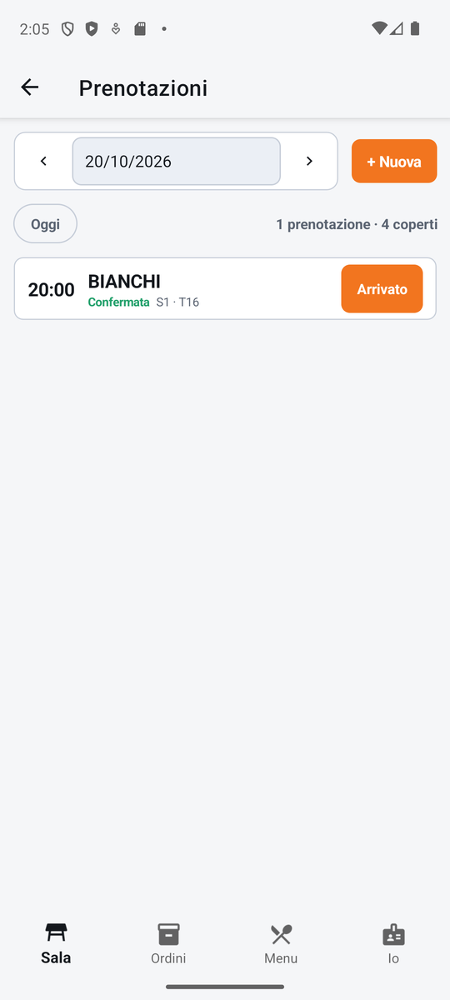
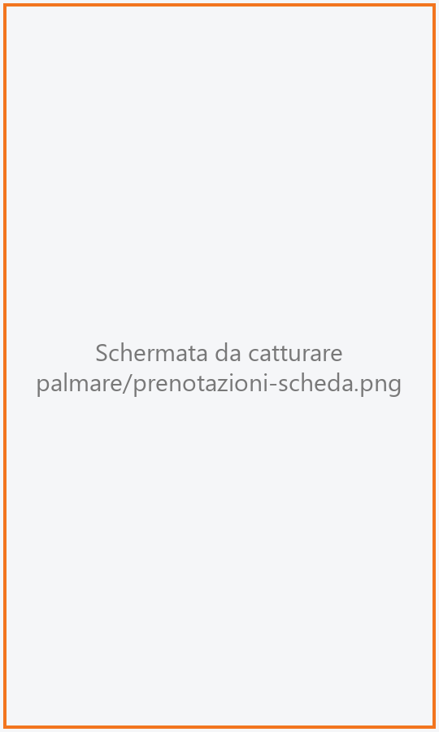
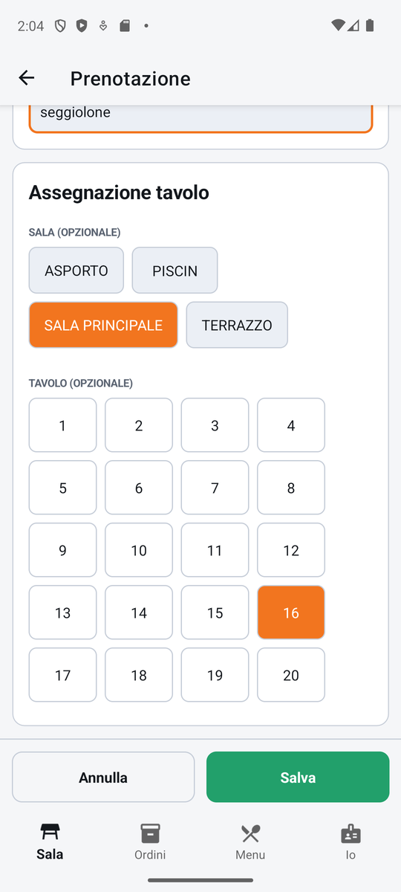

# Prenotazioni

L'elenco delle prenotazioni del giorno, in ordine di orario, con il loro stato e il tavolo
assegnato. Dal palmare si conferma una prenotazione, si fa accomodare il cliente quando arriva (si
apre direttamente il suo tavolo) e si crea o modifica una prenotazione.

!!! info "In sintesi"

    - **Dove si trova:** Sala ▸ **Prenotazioni**
    - **Chi la usa:** cameriere, chi accoglie i clienti all'ingresso
    - **Disponibile anche su:** Cassa ([Prenotazioni](../cassa/prenotazioni.md))

---

## A cosa serve

All'ingresso arriva la famiglia Rossi: il cameriere apre le prenotazioni, trova «20:00 Rossi», tocca
**Arrivato** e si apre subito la comanda del tavolo assegnato, con i coperti della prenotazione.
Durante il giorno si registrano le telefonate («domani alle 21, quattro persone») e si confermano le
richieste arrivate.

## Prima di cominciare

- Per assegnare un tavolo: le sale e i tavoli, che si creano dalla cassa
  ([Sale e tavoli](../cassa/sale-e-tavoli.md)).

## La schermata

{ .telefono }

Dall'alto:

- **la barra del giorno**: la data, fra una freccia a sinistra (giorno prima) e una a destra (giorno
  dopo); toccando la data si apre il calendario. Accanto, **+ Nuova**;
- **Oggi**, per tornare al giorno corrente, e a destra il conteggio del giorno (es. «5 prenotazioni
  · 18 coperti»);
- **l'elenco** delle prenotazioni del giorno: ogni riga ha l'**ora**, il **nome** del cliente, lo
  **stato** in colore e il **tavolo** (es. «S1 · T12», cioè sala 1, tavolo 12, oppure «senza
  tavolo»), e a destra il pulsante dell'azione ovvia: **Conferma** per una prenotazione da
  confermare, **Arrivato** per una confermata. Trascinando la lista verso il basso si aggiorna.

Le prenotazioni annullate, non presentate e quelle dei clienti già arrivati non compaiono
nell'elenco.

### La scheda della prenotazione

{ .telefono }

Toccando una riga si apre dal basso la scheda: nome e stato, **Ora**, **Coperti**, **Tavolo** (es.
«Sala 1, tavolo 12» o «Nessun tavolo assegnato»), e i pulsanti **Conferma prenotazione**,
**Cliente arrivato**, **Modifica**, **Annulla** e **Non presentato** (compaiono solo quelli che
servono allo stato della prenotazione).

### Il modulo della prenotazione

{ .telefono }

**+ Nuova** e **Modifica** aprono la schermata **Prenotazione**, con due riquadri:

- i dati: **Nome cliente**, **Telefono**, **Data**, **Ora**, **Coperti**, **Durata (minuti)**,
  **Note** («Allergie, seggiolone, tavolo tranquillo...»);
- **Assegnazione tavolo**: **SALA (OPZIONALE)** con i pulsanti delle sale e
  **TAVOLO (OPZIONALE)** con i pulsanti dei tavoli della sala scelta. Il tavolo scelto è arancione;
  toccandolo di nuovo si toglie. Sotto possono comparire due avvisi gialli (capacità del tavolo,
  tavolo già prenotato).

In fondo, fissi, **Annulla** e **Salva**.

!!! note "Sul tablet"

    Sul tablet le prenotazioni si gestiscono con la stessa lista e lo stesso modulo del telefono
    (non con il registro a griglia della cassa).

## Campi e indicatori

| Elemento | Descrizione |
|---|---|
| **Stato** | **Da confermare** (viola) o **Confermata** (verde). |
| **S1 · T12** | Sala e tavolo assegnati; «senza tavolo» se non è stato assegnato. |
| **Nome cliente** | Obbligatorio. |
| **Telefono** | Facoltativo. |
| **Data / Ora** | Giorno e ora della prenotazione. Una prenotazione nuova parte da oggi alle 20:00. |
| **Coperti** | Numero di persone (di partenza 2). Deve essere maggiore di zero. |
| **Durata (minuti)** | Quanto si prevede che resti il tavolo occupato (di partenza 90). |
| **Note** | Richieste del cliente. |
| **SALA (OPZIONALE)** | La sala; scegliendola compaiono i suoi tavoli. Se il locale ha una sola sala è già scelta. |
| **TAVOLO (OPZIONALE)** | Il tavolo riservato. Se manca la sala: «Scegli prima una sala». |

## Pulsanti e comandi

| Comando | Effetto |
|---|---|
| **Frecce** ai lati della data | Giorno precedente / successivo. |
| **Oggi** | Torna al giorno corrente. |
| **+ Nuova** | Apre il modulo di una nuova prenotazione. |
| **Conferma** / **Conferma prenotazione** | La prenotazione passa a **Confermata**. |
| **Arrivato** / **Cliente arrivato** | Apre (o riprende) il conto del tavolo assegnato con i coperti della prenotazione, segna la prenotazione come arrivata e porta nella [Comanda](comanda.md). Compare «Apertura tavolo…». |
| **Modifica** | Apre il modulo della prenotazione. |
| **Annulla** (nella scheda) | Annulla una prenotazione **Da confermare**, dopo conferma. |
| **Non presentato** | Segna come non presentato un cliente con prenotazione **Confermata**, dopo conferma. |
| **Salva** | Salva la prenotazione e torna all'elenco. |
| **Annulla** (nel modulo) | Torna all'elenco senza salvare. |

## Come si fa

### Registrare una prenotazione al telefono

1. Tocca **+ Nuova**.
2. Scrivi **Nome cliente** e **Telefono**.
3. Imposta **Data** e **Ora**, scrivi i **Coperti**.
4. Se vuoi, scegli la sala e il tavolo.
5. Tocca **Salva**.
6. La prenotazione compare nel giorno scelto come **Da confermare**.

### Far accomodare un cliente prenotato

1. Apri **Prenotazioni** (dalla [Sala](sala.md)).
2. Trova la prenotazione: deve essere **Confermata** e avere un tavolo.
3. Tocca **Arrivato**.
4. Si apre la [Comanda](comanda.md) del tavolo con i coperti della prenotazione. La prenotazione
   esce dall'elenco e in mappa la sua segnalazione sparisce.

## Controlli e messaggi

| Messaggio | Causa | Cosa fare |
|---|---|---|
| *Il nome del cliente e' obbligatorio.* | **Salva** senza nome. | Scrivi il nome. |
| *Numero di coperti non valido.* | Coperti vuoti o zero. | Scrivi un numero maggiore di zero. |
| *Durata non valida.* | Durata vuota o zero. | Scrivi la durata in minuti. |
| *Attenzione: il tavolo ha al massimo 4 posti, la prenotazione ne richiede 6.* | Il tavolo scelto è piccolo. | Scegli un tavolo più grande, o tienilo e unisci un altro tavolo all'arrivo. |
| **Posti del tavolo** — *… Salvare lo stesso? Al loro arrivo servira' unire un altro tavolo.* | **Salva** con un tavolo troppo piccolo. | **Salva** oppure **Cambia tavolo**. |
| *Attenzione: questo tavolo e' gia' assegnato ad un'altra prenotazione in questa data.* | Il tavolo è già prenotato quel giorno. È solo un avviso. | Controlla gli orari o scegli un altro tavolo. |
| *Assegna un tavolo alla prenotazione prima di far accomodare il cliente.* | **Arrivato** su una prenotazione senza tavolo. | Tocca **Modifica** e assegna il tavolo. |
| **Annulla prenotazione** — *Annullare questa prenotazione? Uscira' dal registro.* | Hai toccato **Annulla** nella scheda. | **Annulla prenotazione** o **Indietro**. |
| **Non presentato** — *Segnare il cliente come non presentato? Uscira' dal registro.* | Hai toccato **Non presentato**. | **Conferma** o **Indietro**. |
| *Impossibile caricare le prenotazioni.* / *Impossibile salvare la prenotazione.* / *Impossibile aggiornare la prenotazione.* / *Impossibile far accomodare il cliente.* | Il servizio non risponde o rifiuta. | Controlla la rete e riprova. |
| *Nessuna prenotazione per questo giorno* — *Tocca "+ Nuova" per crearne una* | Il giorno non ha prenotazioni. | Nessuna. |

## Note

- Se il tavolo assegnato ha già un conto aperto, **Arrivato** non ne apre un secondo: collega la
  prenotazione al conto esistente e apre quella comanda.
- Le prenotazioni confermate compaiono anche sulla [mappa della sala](sala.md), sulla tessera del
  tavolo assegnato, qualche ora prima dell'orario (vedi Impostazioni ▸ **Prenotazioni in mappa**).
- Una prenotazione annullata o non presentata esce dall'elenco e non si recupera dal palmare.
- L'elenco si aggiorna da solo con le prenotazioni fatte dagli altri dispositivi, ma non mentre è
  aperta la scheda di una prenotazione.

## Vedi anche

- [Sala](sala.md)
- [Comanda](comanda.md)
- [Prenotazioni sulla cassa](../cassa/prenotazioni.md)
