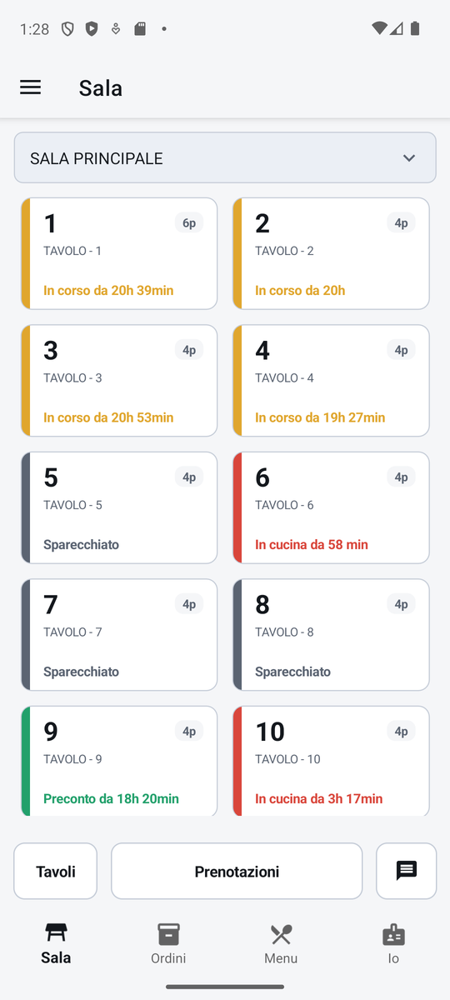
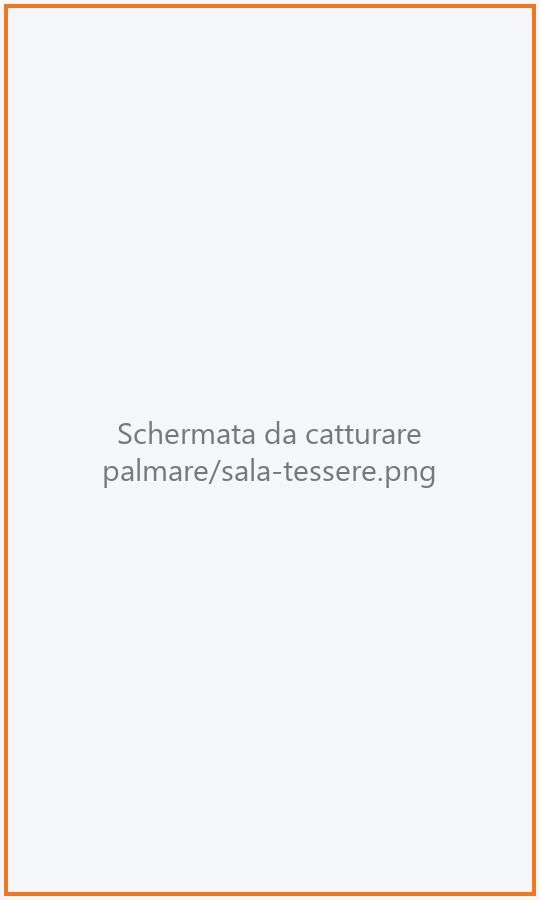
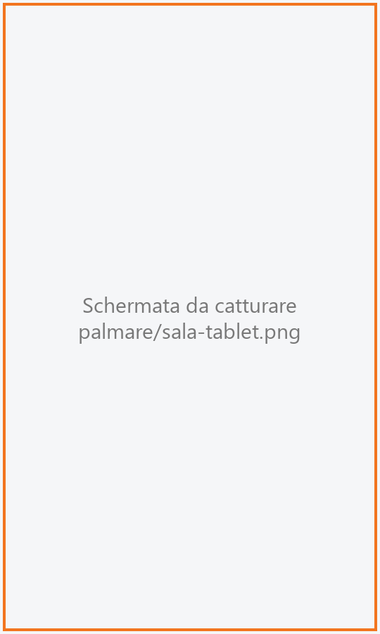
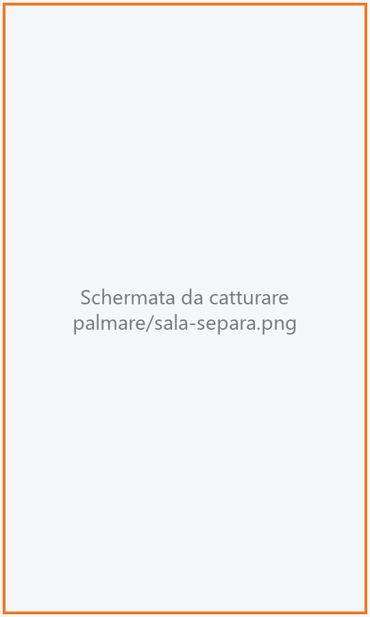

# Sala

La mappa dei tavoli della sala, vista dal telefono. Ogni tessera dice a colpo d'occhio se il tavolo
è libero, appena occupato, in cucina o al conto; toccandola si apre la comanda del tavolo. Serve al
cameriere per tutto il servizio.

!!! info "In sintesi"

    - **Dove si trova:** linguetta **Sala** (è la prima schermata dopo l'accesso)
    - **Chi la usa:** cameriere
    - **Disponibile anche su:** Cassa ([Mappa della sala](../cassa/mappa-sala.md))

---

## A cosa serve

È il punto di partenza del cameriere: da qui apre un tavolo quando i clienti si siedono, ritrova i
tavoli già aperti, vede quali sono in cucina e quali hanno chiesto il preconto. Le tre operazioni
sui tavoli - **sposta**, **unisci**, **separa** - servono quando i clienti cambiano posto, quando
due tavoli diventano una tavolata o quando una parte della tavolata paga a parte.

Esempio: al tavolo 4 si siedono due persone, ne arrivano altre quattro. Unisci il tavolo 5 al
tavolo 4: il conto resta uno solo, sul tavolo 4.

## Prima di cominciare

- Il palmare deve essere collegato al servizio (vedi [Impostazioni](impostazioni.md)): se non lo è,
  all'apertura si passa direttamente alle Impostazioni.
- Sale e tavoli si creano dalla cassa (vedi [Sale e tavoli](../cassa/sale-e-tavoli.md)).
- Per riconoscere il tavolo dell'asporto, nelle Impostazioni del palmare va scelto il **Tavolo
  asporto** (vedi [Impostazioni](impostazioni.md)).

## La schermata

{ .telefono }

Dall'alto in basso:

- **la sala**: un campo con il nome della sala che stai guardando. Toccandolo si apre l'elenco
  **Sala** con tutte le sale; la sala aperta ha il bordo evidenziato. Il palmare ricorda la sala
  scelta finché l'app resta aperta;
- **i tavoli**, in tessere affiancate (due per riga sul telefono in verticale, di più se lo schermo
  è largo), nell'ordine stabilito per la sala dalla cassa. La lista scorre;
- in fondo alla lista, la **Legenda** dei colori e, se ci sono, gli **Avvisi** sui piatti che
  stanno finendo (per esempio *Tiramisù: ultime 3 porzioni*);
- in basso, fissa, la **barra dei comandi**: **Tavoli**, **Prenotazioni** e l'icona dei messaggi
  alla cucina.

### La tessera del tavolo

{ .telefono }

Ogni tessera porta:

- a sinistra una **barra colorata** con lo stato del tavolo (vedi la legenda qui sotto);
- il **numero del tavolo**, grande;
- i **posti** del tavolo (es. **4p**);
- la descrizione del tavolo, oppure il riquadro **Unito a 12** se il tavolo fa parte di una tavolata
  il cui conto sta sul tavolo 12, oppure il riquadro **Asporto** sul tavolo degli ordini d'asporto;
- in basso lo **stato in chiaro** e da quanto tempo il tavolo è aperto, per esempio
  «Occupato da 25 min», «In cucina da 1h 10min», «Preconto da 2h». Sul tavolo dell'asporto c'è
  invece il numero di ordini in coda: «nessun ordine», «1 ordine», «3 ordini»;
- se il tavolo ha una **prenotazione** confermata in arrivo, l'**ora** della prenotazione in azzurro
  accanto al numero e una **banda azzurra** sul lato destro della tessera.

La durata è quella del momento in cui la mappa è stata disegnata: si aggiorna ogni volta che la
mappa si ricarica.

### Legenda dei colori

| Colore | Stato | Significato |
|---|---|---|
|  grigio | **Libero** | Nessun conto aperto. |
|  viola | **Occupato** | Tavolo aperto, non è ancora stato battuto niente. |
|  ambra | **In corso** | Sono stati battuti dei piatti, non ancora mandati in cucina. |
|  rosso | **In cucina** | La comanda è stata inviata in cucina. |
|  verde | **Preconto / Conto** | È stato fatto il preconto o si sta facendo il conto. |
|  azzurro | **Prenotato** | Tavolo riservato. Anche il tavolo dell'asporto è azzurro. |

<!-- DA VERIFICARE: lo stato "Prenotato" di un tavolo (tessera tutta azzurra) da chi viene impostato? Dal codice la prenotazione in arrivo si vede solo con l'ora e la banda azzurra a destra. -->

!!! note "Sul tablet"

    Nella forma tablet le sale sono pulsanti in fila in alto (non un elenco a tendina), i tavoli
    stanno in una griglia da sei per riga e il colore dello stato è il **bordo** della tessera, che
    mostra numero, descrizione e posti («4 posti») ma non lo stato in chiaro. A destra c'è una
    colonna con gli **Avvisi** e la **Legenda**. In basso i pulsanti sono tutti in vista:
    **Sposta**, **Unisci**, **Separa**, **Vendita al banco**, **Asporto e domicilio**,
    **Prenotazioni** e **Messaggi**; quando un'operazione è in corso compaiono **Annulla** e la
    riga che dice cosa toccare.

    

## Campi e indicatori

| Elemento | Descrizione |
|---|---|
| **Campo della sala** | Il nome della sala aperta. Toccalo per cambiare sala dall'elenco **Sala**. |
| **Numero del tavolo** | Il codice del tavolo. |
| **Posti (es. 4p)** | I posti del tavolo, come impostati in [Sale e tavoli](../cassa/sale-e-tavoli.md). |
| **Unito a …** | Il tavolo fa parte di una tavolata: il conto sta sul tavolo indicato. |
| **Asporto** | È il tavolo virtuale degli ordini d'asporto e a domicilio. |
| **Kiosk** · «Ordini del kiosk» | È un tavolo virtuale dei kiosk: gli ordini del kiosk si gestiscono dalla cassa, in [Ordini dal kiosk](../cassa/ordini-kiosk.md). |
| **Stato e durata** | Lo stato del tavolo con il tempo trascorso dall'apertura (es. «In corso da 40 min»). |
| **Ora in azzurro** | Ora della prossima prenotazione confermata su quel tavolo, non ancora arrivata. |
| **Legenda** | Il significato dei colori. |
| **Avvisi** | Piatti con le scorte basse: «nome: ultime N porzioni». |

La prenotazione compare sulla tessera da un certo numero di ore prima dell'orario prenotato e resta
finché il cliente non viene segnato come arrivato. Il numero di ore si imposta in
Impostazioni ▸ **Prenotazioni in mappa** (da 0, che spegne la segnalazione, a 24; di partenza 1).

## Pulsanti e comandi

| Comando | Effetto |
|---|---|
| **Tocco su un tavolo** | Apre la [Comanda](comanda.md) del tavolo. Su un tavolo libero chiede prima conferma. Sul tavolo dell'asporto apre la coda degli [Ordini](ordini.md). Su un tavolo unito apre il conto del tavolo principale. |
| **Tavoli** | Apre il pannello **Operazioni sui tavoli** con **Sposta tavolo**, **Unisci tavoli**, **Separa tavolo** e **Annulla**. |
| **Prenotazioni** | Apre il registro delle [Prenotazioni](prenotazioni.md). |
| **Icona dei messaggi** | Apre i [Messaggi alla cucina](messaggi.md). |
| **Annulla** (nella barra) | Compare durante uno spostamento, un'unione o una separazione: interrompe l'operazione. |

Mentre un tavolo si apre compare la scritta **Apertura tavolo…** su tutto lo schermo: aspetta che
si apra la comanda, non serve toccare di nuovo.

La mappa si aggiorna da sola con quello che fanno gli altri dispositivi (cassa, altri palmari) ogni
pochi secondi, secondo quanto impostato in Impostazioni ▸ **Aggiornamento automatico**. Non si
aggiorna mentre stai facendo uno spostamento, un'unione o una separazione.

## Come si fa

### Aprire un tavolo

1. Se serve, tocca il campo della sala e scegli la sala.
2. Tocca il tavolo libero.
3. Alla domanda *Vuoi occupare il tavolo 7?* tocca **Occupa**.
4. Si apre la [Comanda](comanda.md) del tavolo; tornando in sala il tavolo è viola (**Occupato**).

### Spostare i clienti su un altro tavolo

1. Tocca **Tavoli**, poi **Sposta tavolo**.
2. In basso compare **Sposta tavolo** con l'istruzione «Tocca il tavolo da spostare»: tocca il
   tavolo dove sono seduti i clienti.
3. L'istruzione diventa «Tavolo 7: tocca il tavolo di destinazione»: tocca il tavolo libero dove si
   spostano.
4. Il conto passa sul nuovo tavolo con lo stesso stato; il tavolo di partenza torna libero.

Il tavolo di destinazione deve essere libero. Se il tavolo di destinazione ha meno posti dei coperti
del conto, lo spostamento si ferma con un avviso.

### Unire due tavoli

1. Tocca **Tavoli**, poi **Unisci tavoli**.
2. Tocca il tavolo che **tiene il conto** («Tocca il tavolo che tiene il conto»).
3. Tocca il tavolo da unire («Conto sul tavolo 4: tocca il tavolo da unire»).
4. Il secondo tavolo mostra **Unito a 4**. Se aveva già un conto aperto, i suoi piatti e i suoi
   coperti passano sul conto del tavolo 4.

### Separare una parte della tavolata

1. Tocca **Tavoli**, poi **Separa tavolo**.
2. Tocca il tavolo da separare.
3. Nel pannello **Righe da separare** spunta i piatti che passano sull'altro tavolo (**Tutte** e
   **Nessuna** spuntano o tolgono tutto). Con **–** e **+** in **Coperti da spostare** scegli anche
   quanti coperti passano.
4. Tocca **Scegli il tavolo**.
5. Tocca il tavolo libero di destinazione.
6. Sul nuovo tavolo si apre un conto con i piatti e i coperti scelti.

{ .telefono }

I coperti già pagati restano sul tavolo di partenza. Se un piatto è composto (per esempio una pizza
mezza e mezza) le sue parti seguono il piatto.

<!-- DA VERIFICARE: come si scioglie un'unione dal palmare (riportare libero un tavolo "Unito a")? Dal codice sembra possibile con Separa dal tavolo principale verso il tavolo unito, ma va provato. -->
### Cambiare sala

1. Tocca il campo con il nome della sala.
2. Nell'elenco **Sala** tocca la sala che vuoi vedere.
3. La mappa mostra i tavoli della nuova sala.

## Controlli e messaggi

| Messaggio | Causa | Cosa fare |
|---|---|---|
| **Tavolo libero** — *Vuoi occupare il tavolo 7?* | Hai toccato un tavolo libero. Aprendolo il tavolo risulta occupato. | **Occupa** per aprirlo, **Annulla** se era un tocco involontario. |
| *Il tavolo 5 e' unito al 4: si apre il conto del 4.* | Hai toccato un tavolo unito. | Nessuna: lavori sul conto del tavolo principale. |
| *Il tavolo 20 e' quello degli ordini d'asporto: sposta/unisci/separa non si applicano.* | Hai scelto il tavolo dell'asporto durante un'operazione. | Gli ordini d'asporto si gestiscono dagli [Ordini](ordini.md). |
| *Gli ordini del kiosk si gestiscono dalla cassa* | Hai toccato il tavolo dei kiosk. | Usa la cassa ([Ordini dal kiosk](../cassa/ordini-kiosk.md)). |
| *Il tavolo 1 e' quello degli ordini del kiosk: sposta, unisci e separa non si applicano.* | Hai scelto il tavolo dei kiosk durante un'operazione. | Gli ordini del kiosk si gestiscono dalla cassa. |
| *Il tavolo 5 e' gia' unito a un altro conto: parti dal tavolo che tiene il conto.* | Unione o separazione partendo da un tavolo unito. | Parti dal tavolo principale. |
| *Il tavolo 7 non ha un conto aperto.* | Unione o separazione partendo da un tavolo libero. | Scegli un tavolo con un conto aperto. |
| *Il tavolo di partenza non ha una comanda aperta.* | Spostamento di un tavolo senza conto. | Scegli un tavolo aperto. |
| *6 coperti non stanno sul tavolo Finestra: ha al massimo 4 posti.* | Il tavolo di destinazione ha meno posti dei coperti. Nella separazione il messaggio aggiunge *Scegli un altro tavolo.* | Scegli un tavolo più grande, oppure unisci prima un altro tavolo. |
| *Su questo tavolo non c'e' niente da separare.* | Il conto non ha né piatti né coperti da spostare. | Nessuna. |
| *Scegli almeno una riga o qualche coperto da separare.* | **Scegli il tavolo** senza aver scelto nulla. | Spunta almeno un piatto o un coperto. |
| *Impossibile spostare il tavolo.* / *Impossibile unire i tavoli.* / *Impossibile separare il tavolo.* | Il servizio ha rifiutato l'operazione; sotto compare il motivo (es. tavolo di destinazione già occupato). | Leggi il motivo, scegli un altro tavolo e riprova. |
| *Impossibile caricare la mappa della sala.* / *Impossibile caricare i tavoli della sala.* / *Impossibile leggere il conto del tavolo.* | Il servizio non risponde. | Controlla la rete e il collegamento in [Impostazioni](impostazioni.md). |
| *Nessun tavolo in questa sala* — *I tavoli si configurano dalla cassa* | La sala non ha tavoli. | Crea i tavoli dalla cassa. |

## Note

- Toccare un tavolo libero **apre il conto**: il tavolo resta occupato finché non lo liberi. Se lo
  hai aperto per sbaglio e non hai battuto niente, usa **LIBERA TAVOLO** nella
  [Comanda](comanda.md).
- Durante uno spostamento, un'unione o una separazione, toccare di nuovo il tavolo di partenza
  annulla l'operazione.
- Gli spostamenti fatti dal palmare si vedono subito anche sulla cassa e sugli altri palmari.

## Vedi anche

- [Comanda](comanda.md)
- [Ordini](ordini.md)
- [Prenotazioni](prenotazioni.md)
- [Messaggi](messaggi.md)
- [Mappa della sala sulla cassa](../cassa/mappa-sala.md)
- [Sale e tavoli](../cassa/sale-e-tavoli.md)
